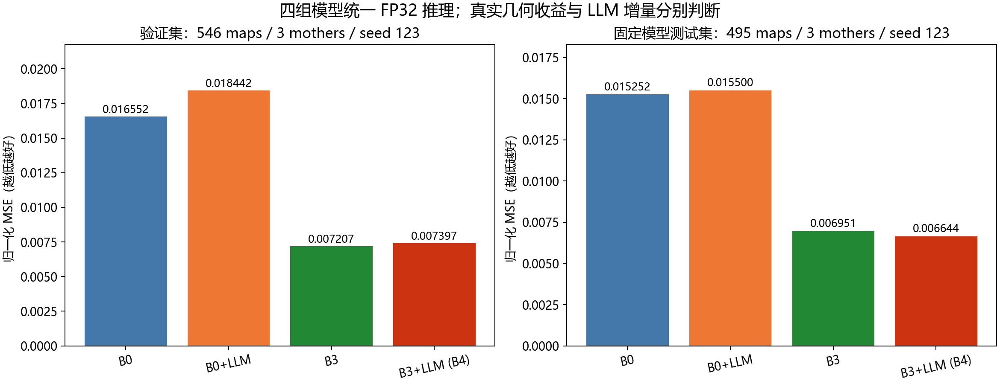
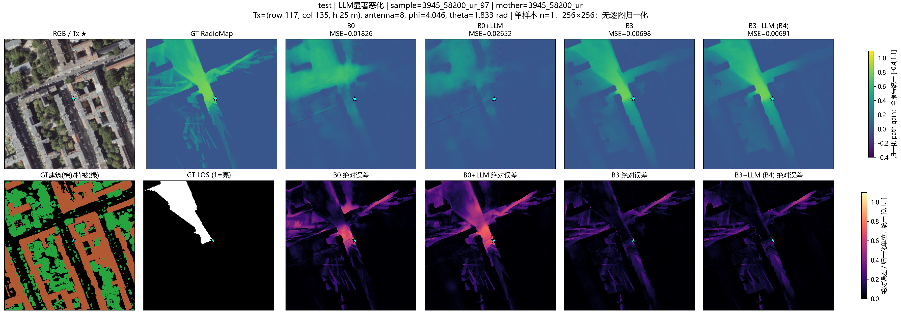
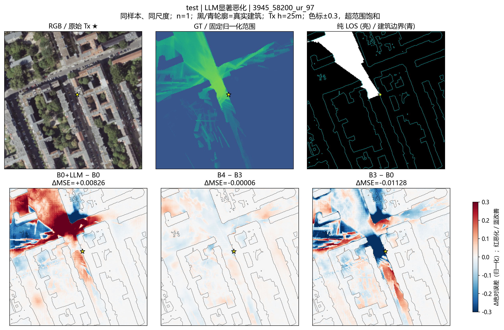
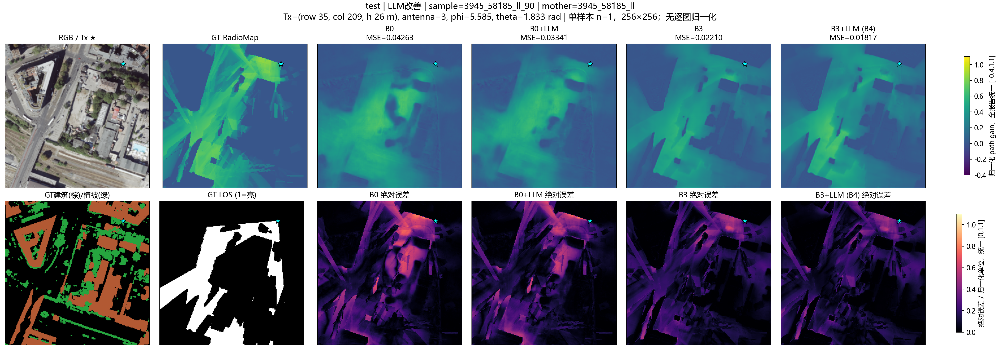
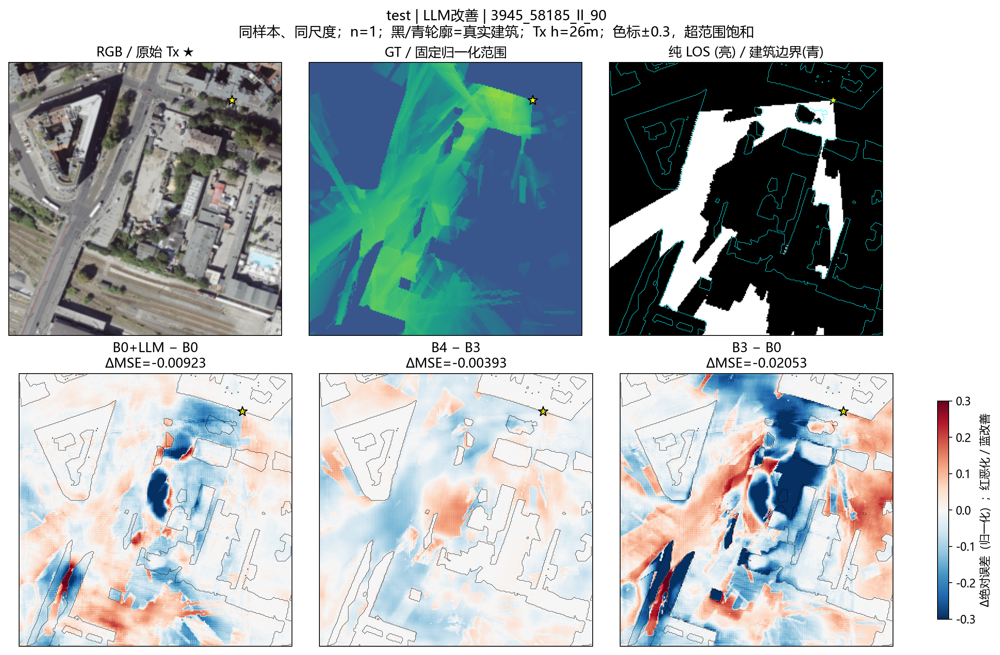
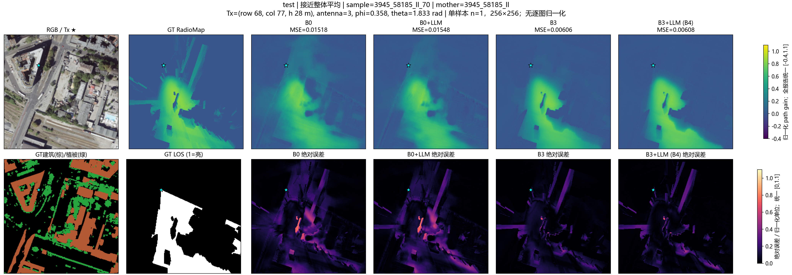
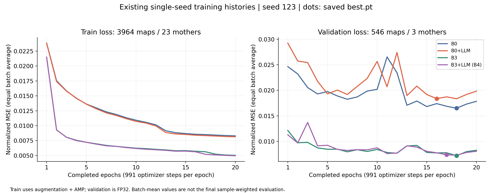
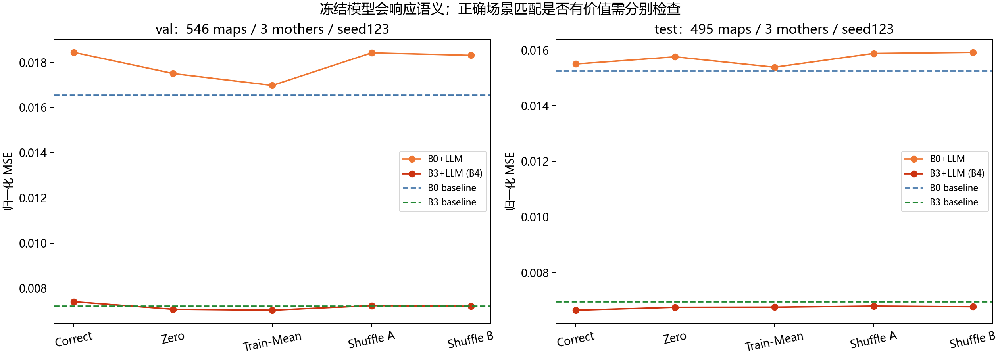
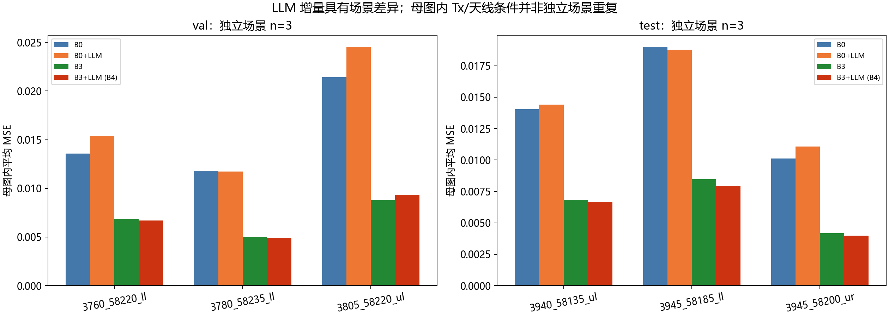
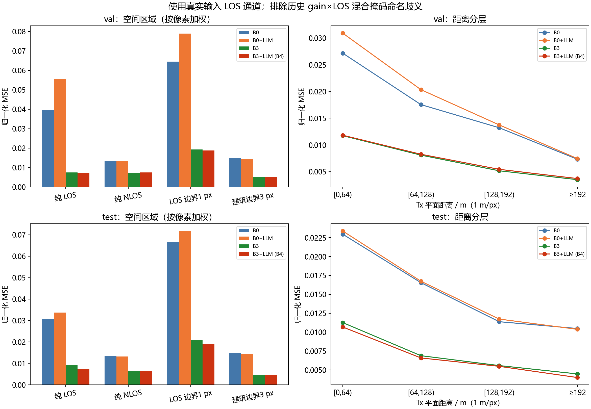

# 01 LLM语义对照

检验全局LLM语义能否改善RadioMap，以及语义条件变化是否影响预测。Fair 29按母图划分为23训练、3验证、3测试；四模型均为seed123、20轮，比较保存权重的统一FP32复评结果。

B0＋LLM在验证/测试上相对B0退化11.42%/1.63%；B4相对B3在验证退化2.64%、测试改善4.42%。真实几何有明显价值，LLM语义的收益依赖评价场景，不能概括为始终有效或始终无效。

## 结果图片

### 四模型整体性能：验证与测试

### 退化案例：四模型预测与绝对误差

### 退化案例：误差变化，红差蓝好

### 改善案例：四模型预测与绝对误差

### 改善案例：误差变化，红差蓝好

### 普通案例：接近总体平均

### 四模型训练与验证曲线

### 语义置零、训练均值与两种错配

### 逐母图结果：验证与测试

### LOS、遮挡边界与距离分区

固定输入干预说明模型会使用条件通路，但不能单独证明语义内容造成训练收益或退化。四模型仅一个训练seed，验证和测试各3个独立母场景；训练日志与保存权重复评的数值口径不同。

[返回实验总览](../README.md)
