# 02 语义质量验证

分别检查旧13字段的场景区分度、MLP表示，以及建筑/植被覆盖率在整图和8×8网格上的准确性。

29母图中，13字段有7项恒定或缺失，类别向量及两组MLP表示均只有19种。Astra整图建筑/植被覆盖率MAE为3.75/3.38个百分点；网格实验共34图，其中29张扩展图的逐格MAE为14.15/13.51个百分点。整图估计和局部网格是不同任务：存在粗粒度与空间信号，局部误差和重复波动仍明显。

## 结果图片

### 13字段变化与熵

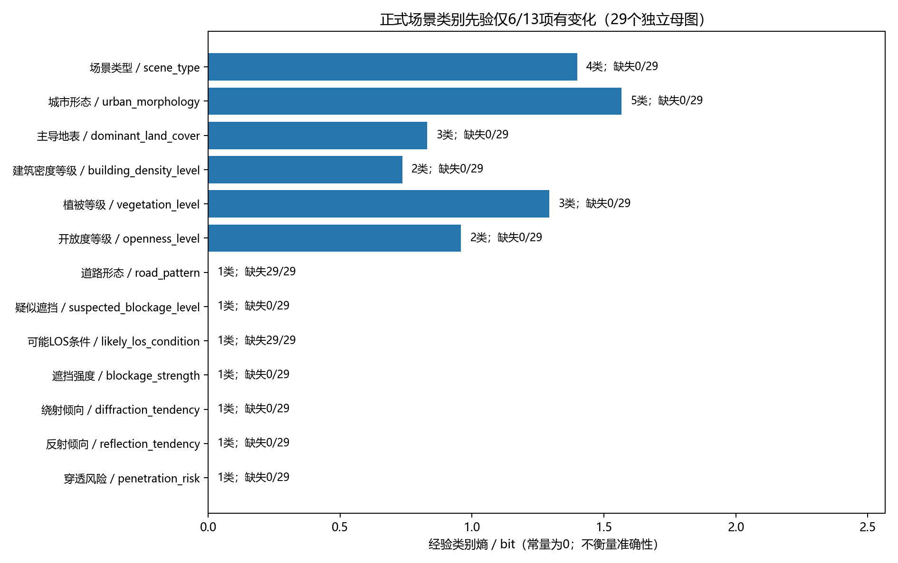

### 类别字段之间的NMI

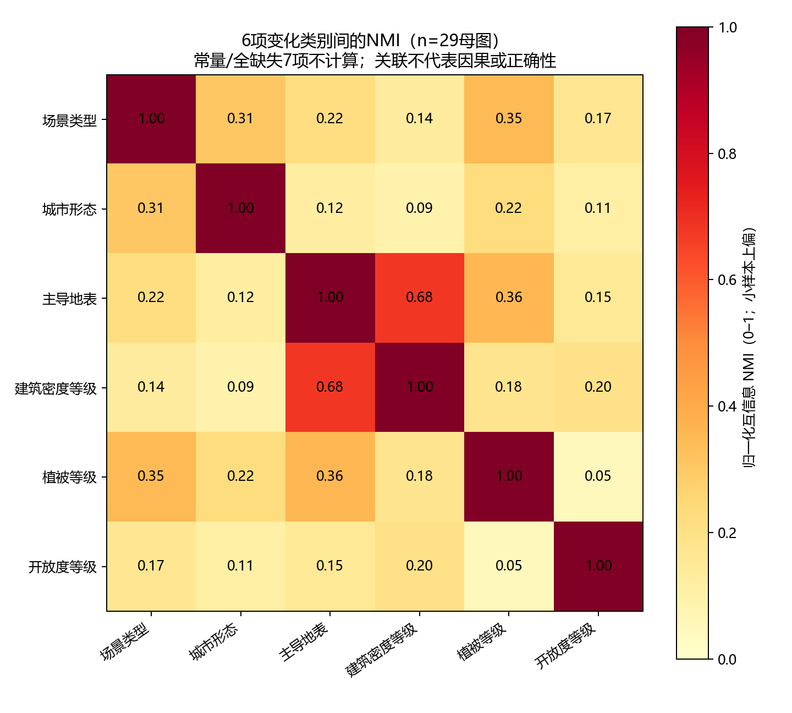

### 相同语义先验，不同空间布局

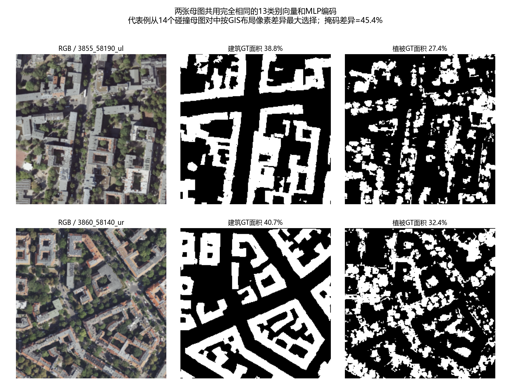

### 类别与MLP表示的区分度

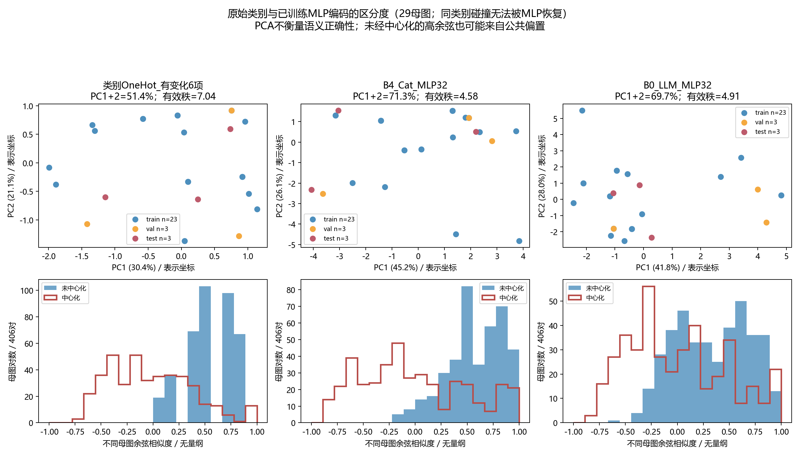

### 历史连续覆盖率与参考

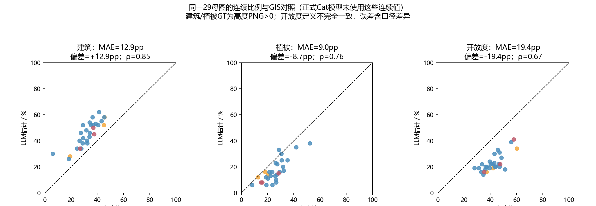

### 历史5图网格与简单基线

### Astra 29图整图覆盖率

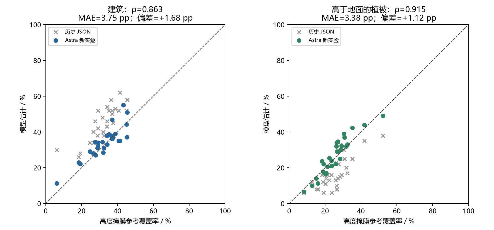

### 整图覆盖率重复稳定性

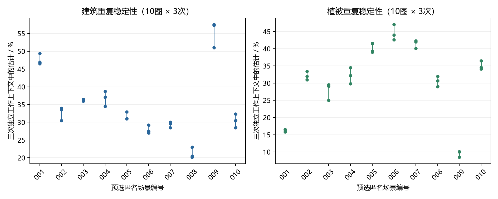

### 34图网格实验：总体指标与分组对照

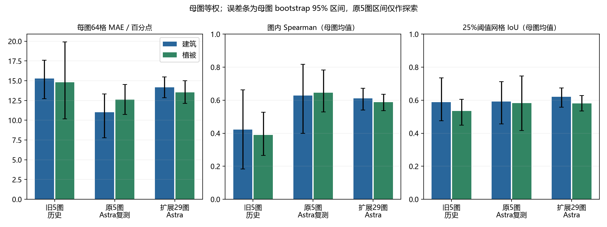

### 网格位置打乱与重复稳定性

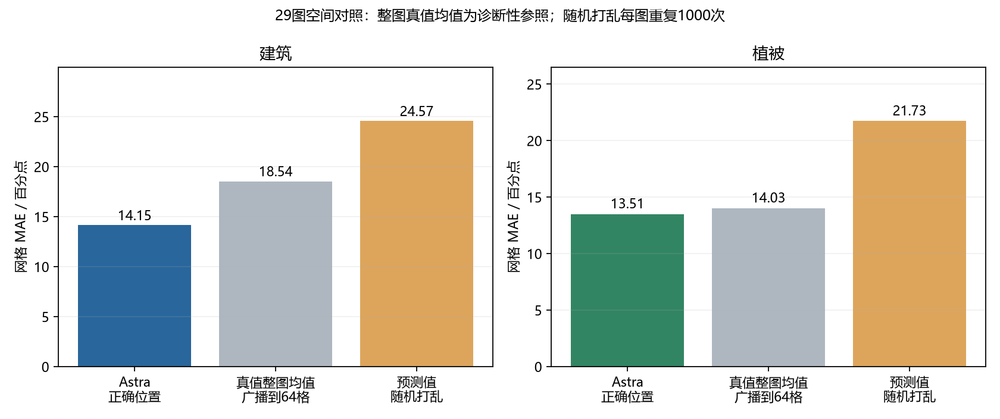

### 整图准确与网格准确的区别

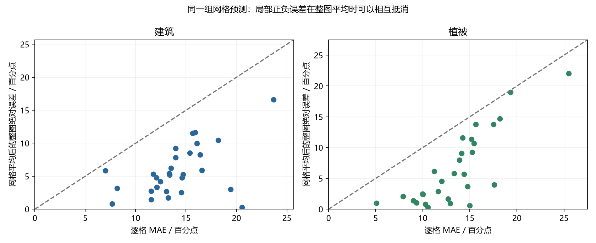

### 网格例图：扩展29图中的第1图

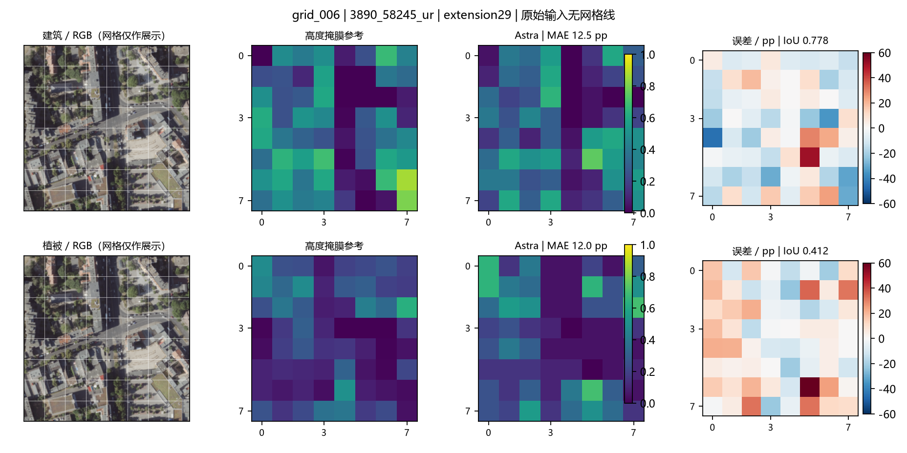

### 网格例图：重复波动

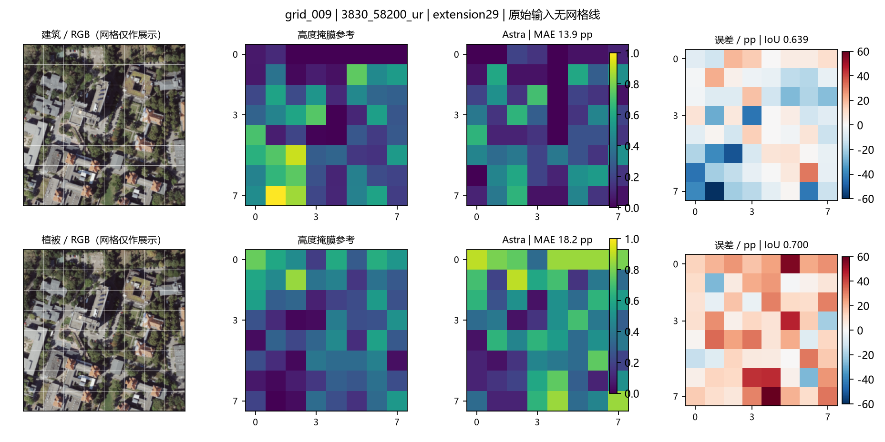

### 补充组会截图：13字段区分度

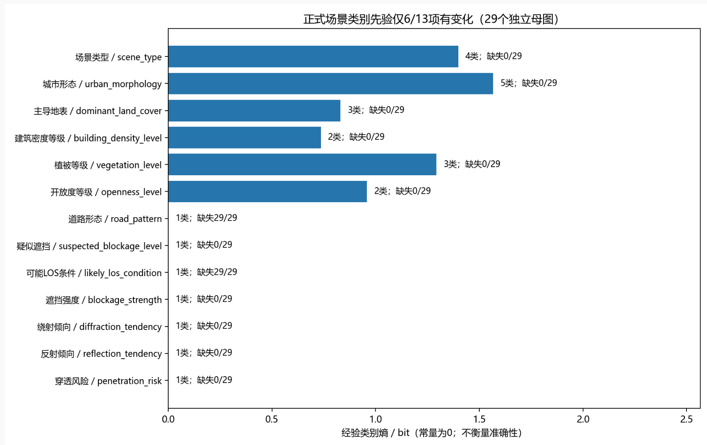

### 补充组会截图：相同语义与不同布局

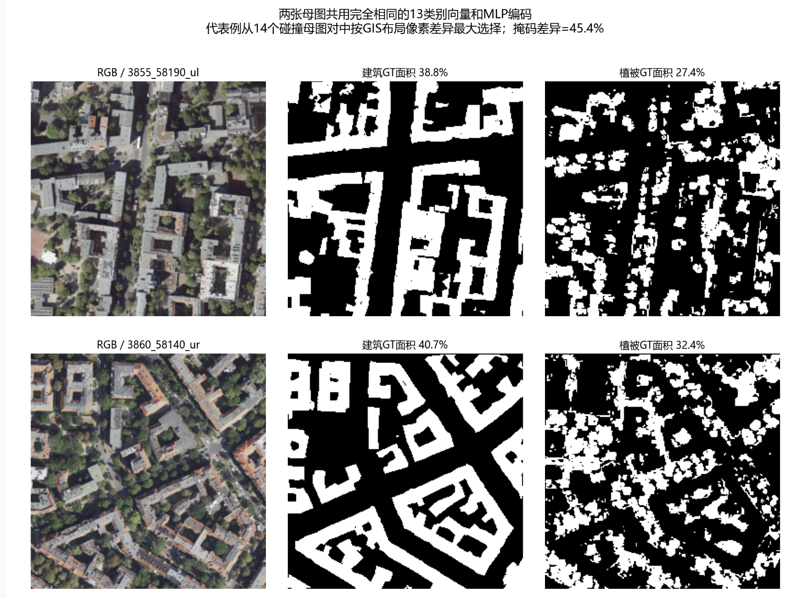

### 补充组会截图：整图覆盖率

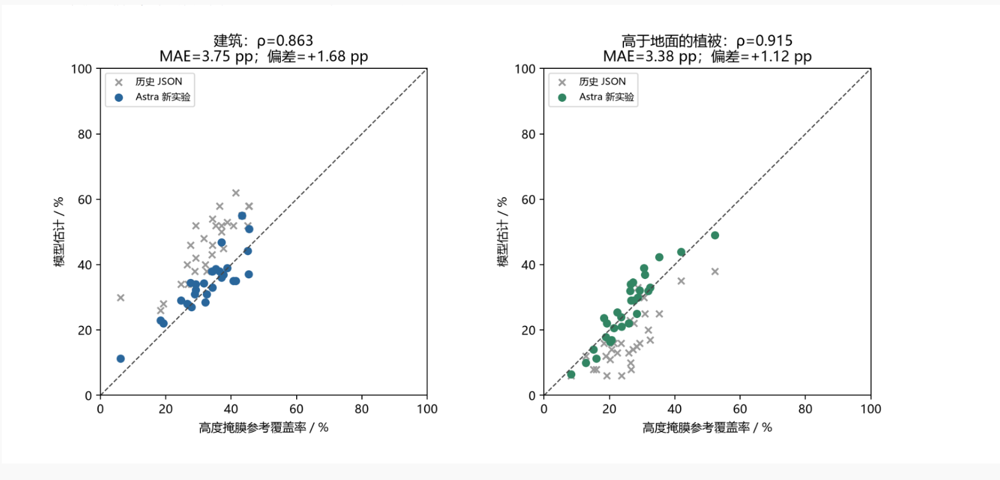

### 补充组会截图：网格局部例图

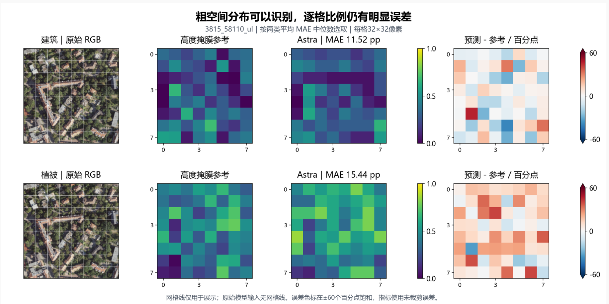

### 补充组会截图：网格结果与控制

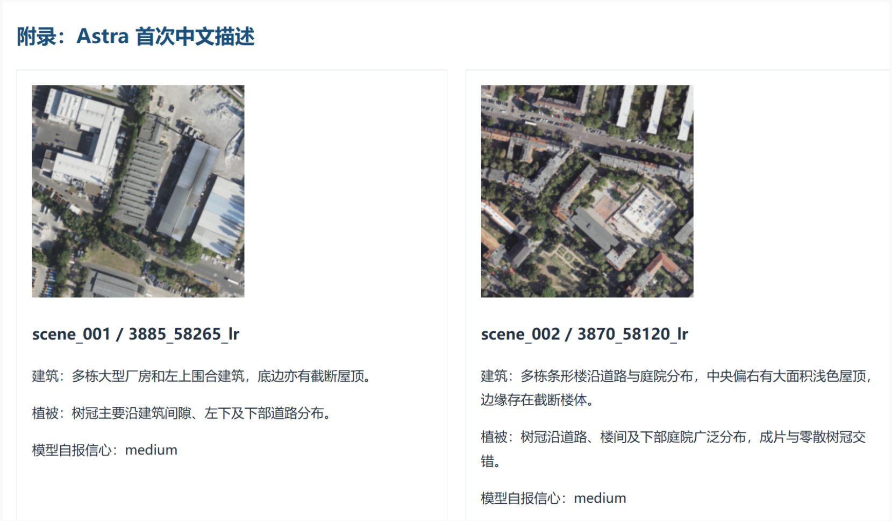

覆盖率参考来自高度掩膜，网格IoU也不等于像素分割IoU。64个网格不能视作64个独立场景。这组能力评价没有直接检验RadioMap下游收益。

[返回实验总览](../README.md)
