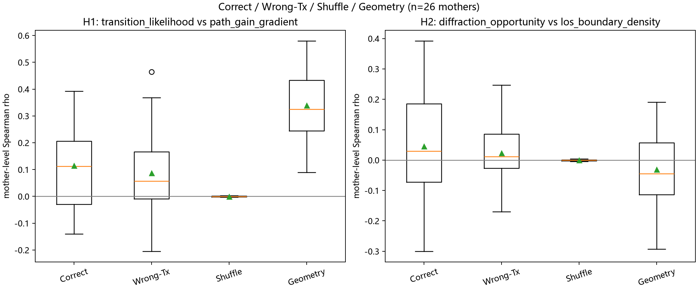
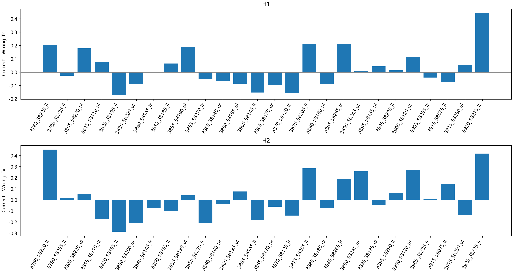
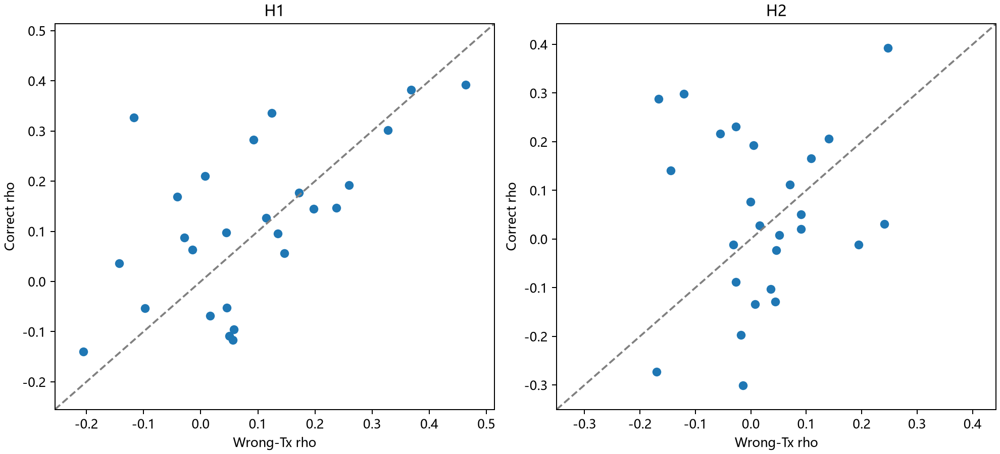
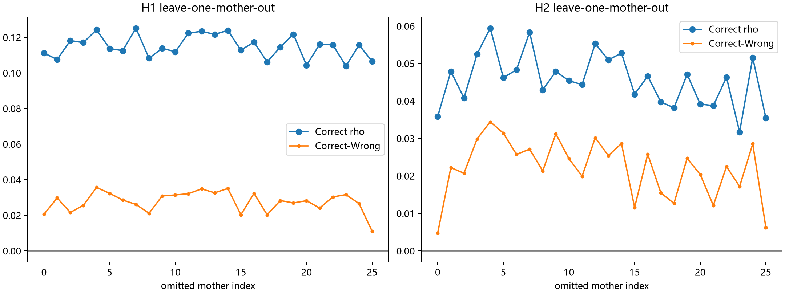
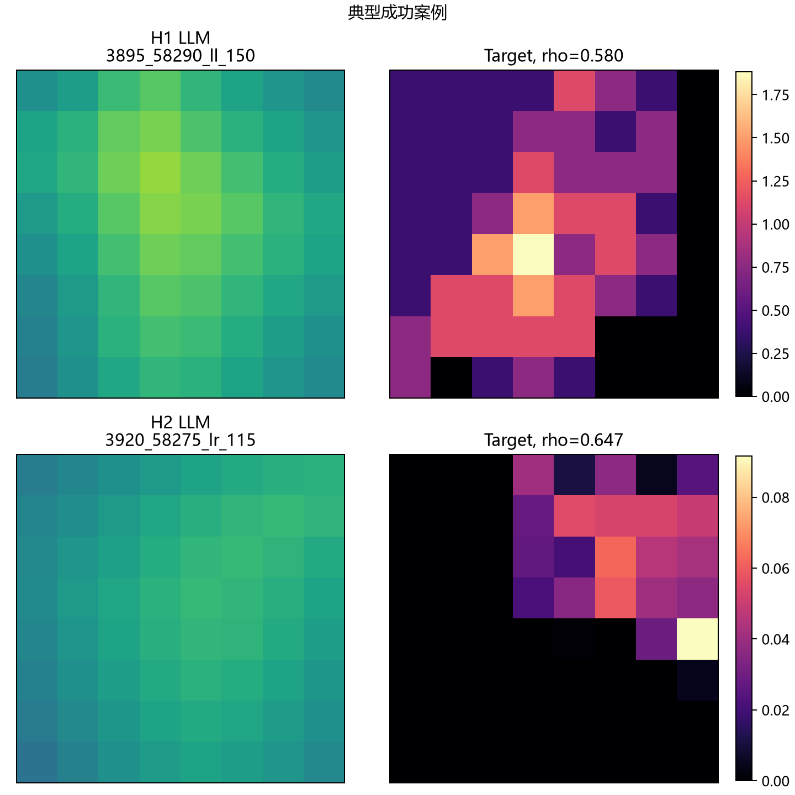
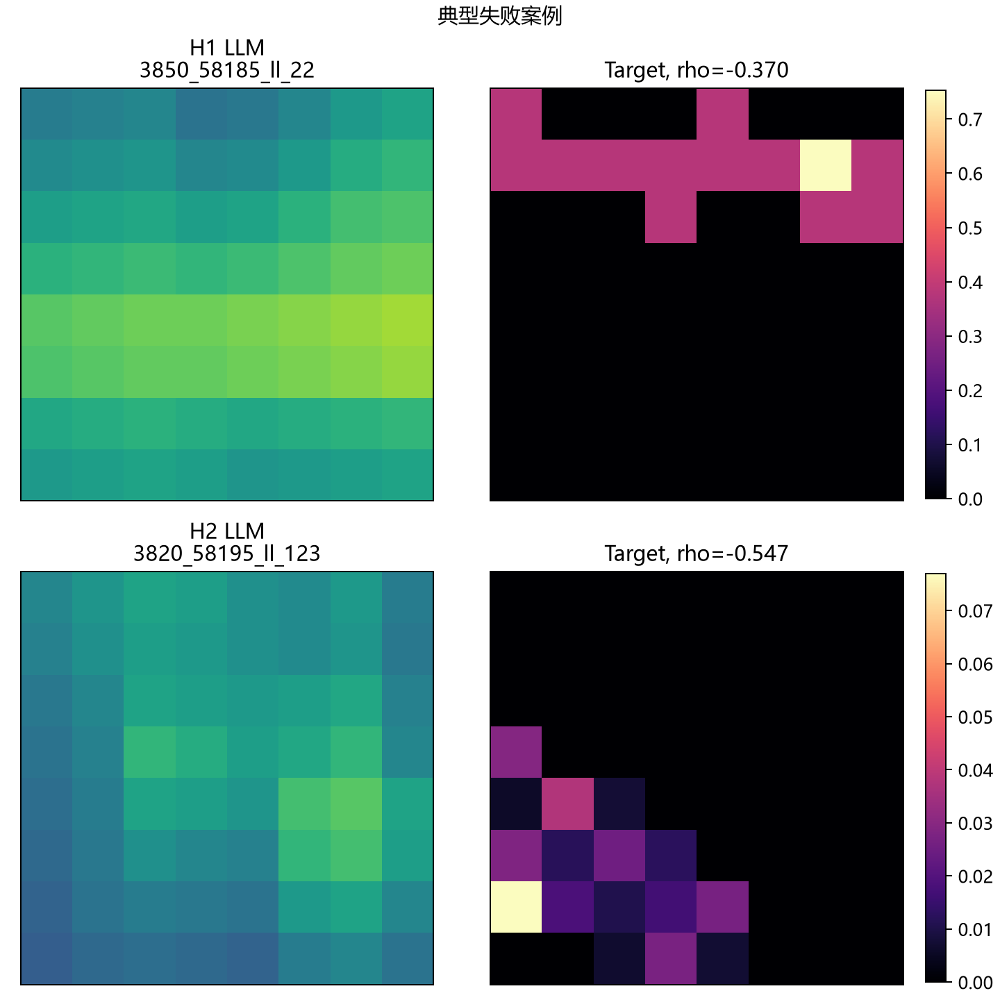
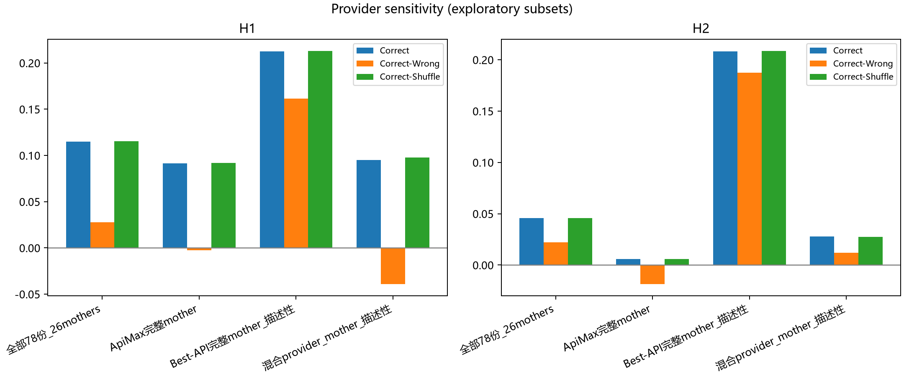

# Tx条件空间语义

检验根据RGB与Tx标记生成的8×8空间先验，是否与真实Path Gain/LOS代理对齐，并随Tx位置正确变化。26母图，每图3个Tx，共78份先验；独立统计单位为母图。

部分场景级空间对应较弱但非随机，尚未通过完整Tx特异性标准。H1的Correct相关系数为0.1150，Wrong-Tx为0.0874，Geometry为0.3391；服务商与场景构成的敏感性限制了总体解释。

## 结果图片

### 四类对照箱线图

### 逐母图Correct减Wrong-Tx

### 母图级Correct与Wrong-Tx散点

### 逐一留出母图的稳定性

### 相对成功的空间热力图案例

### 失败的空间热力图案例

### 服务商与场景构成敏感性

相关性不等于真实绕射路径、因果解释或下游收益；服务商间的差异也不能脱离场景分配直接归因。[返回本组目录](../README.md)。

[返回实验总览](../../README.md)
