# P0：三维几何正对照

使用确定性射线几何，检验正确建筑/植被高度是否比空间错置高度更接近LOS/NLOS参考。本实验为26母图、78 Tx，不调用VLM。

正确高度在主AUROC与8×8相关性比较中具有可检测价值，正对照通过。错误高度保持二维掩膜与高度多重集合，检验的是高度空间位置。LOS-floor主分析接收高度为0m；RadioMap的1.5m接收高度属于另一口径。

## 结果图片

### 正确与错误高度输入

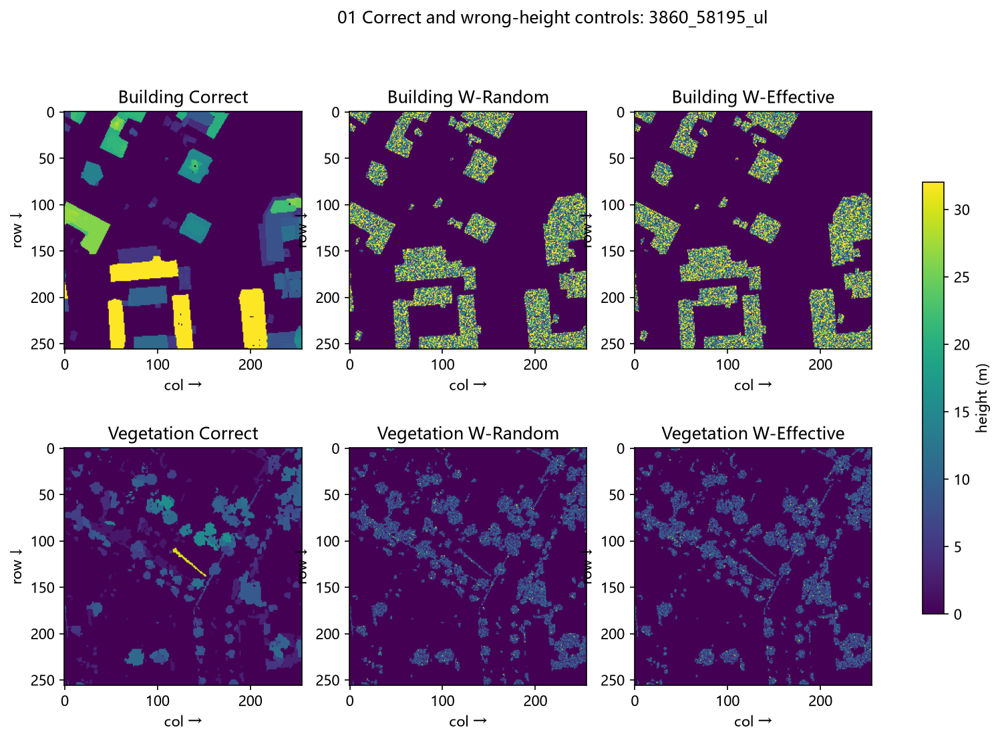

### 高度直方图保持检查

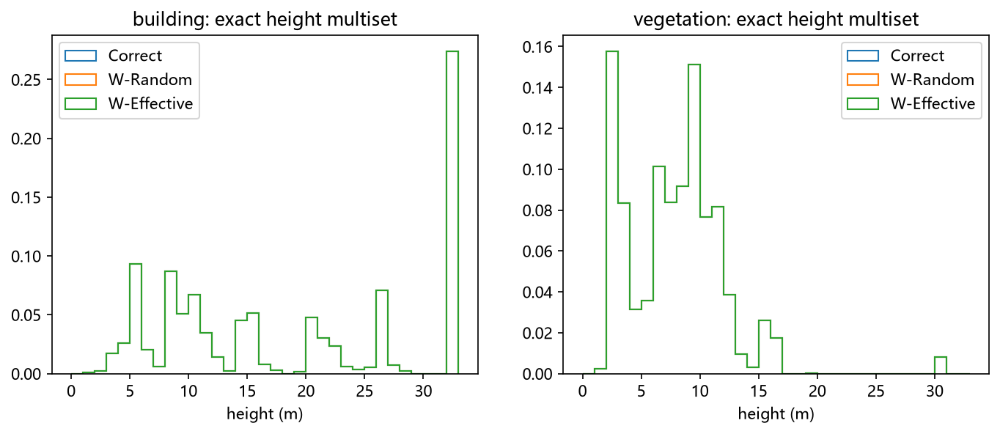

### 二维掩膜一致性检查

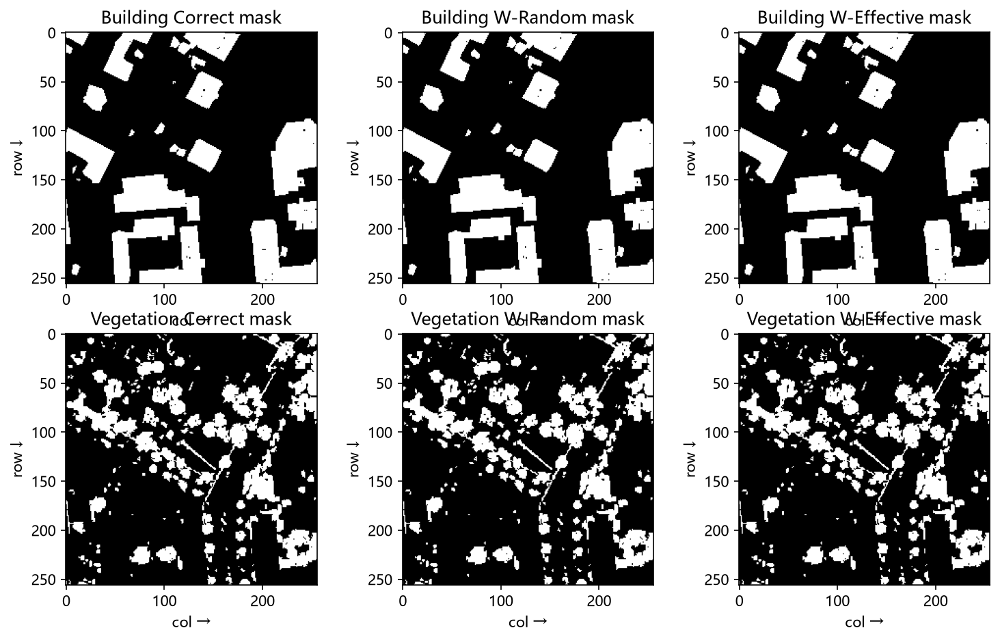

### 射线与接收高度定义

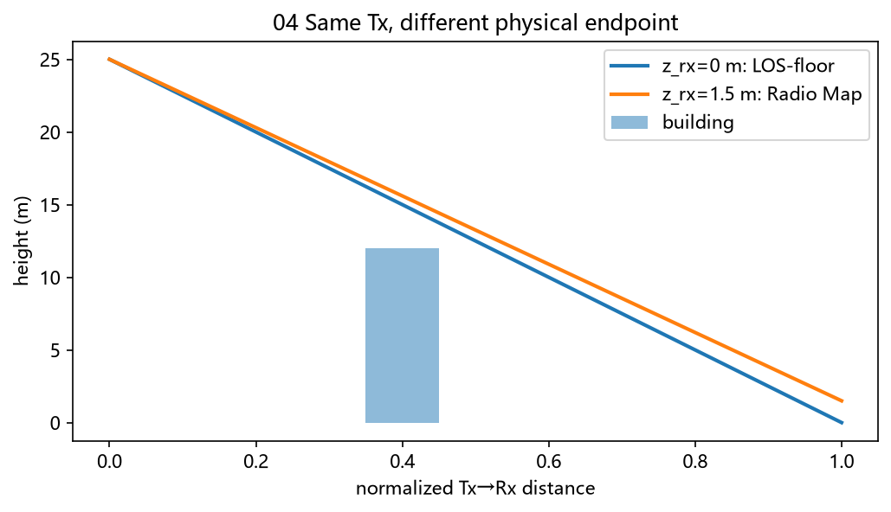

### 二值与比例参考的区别

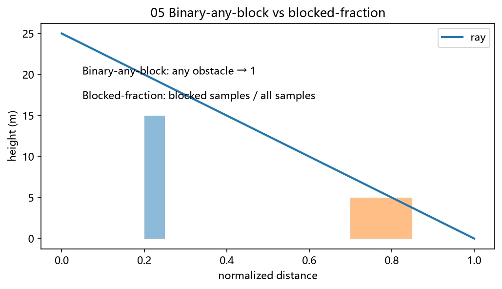

### 主结果：NLOS AUROC

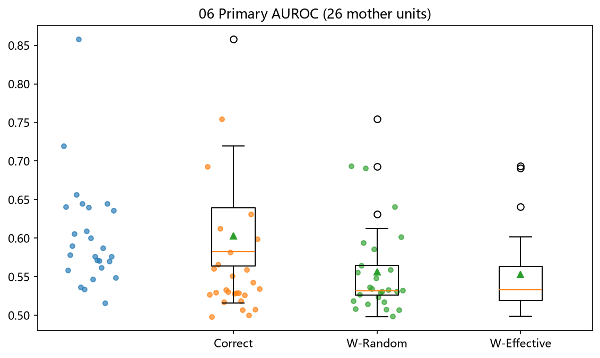

### 主结果：NLOS相关性

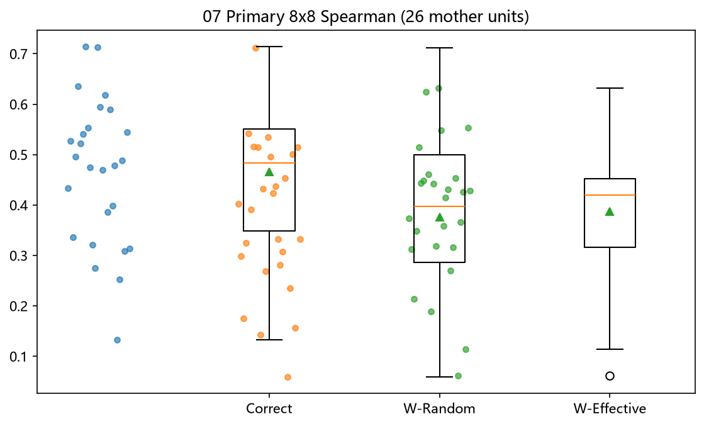

### 逐母图效应

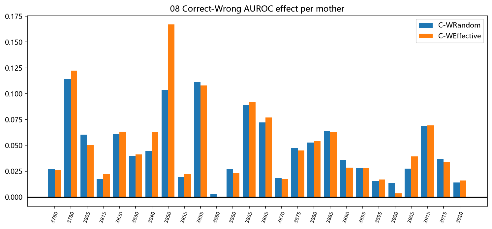

### 高度分层对照

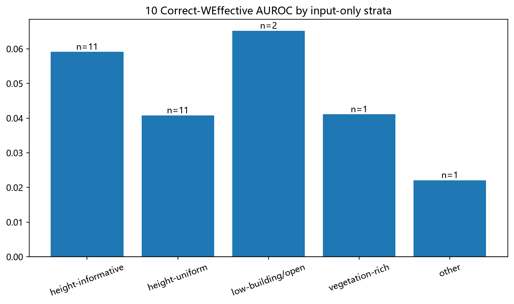

### 射线采样敏感性

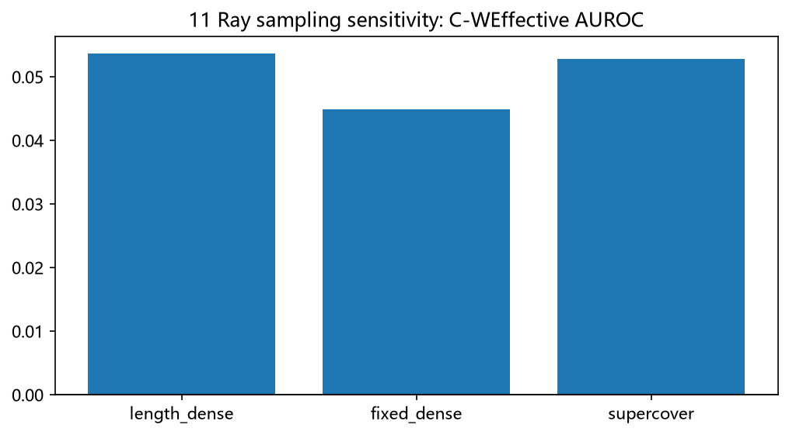

### 接收高度敏感性

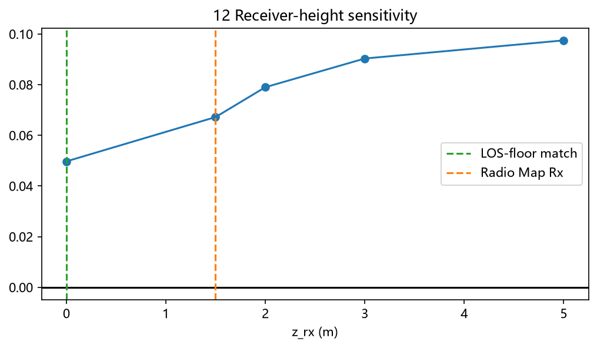

### 成功案例

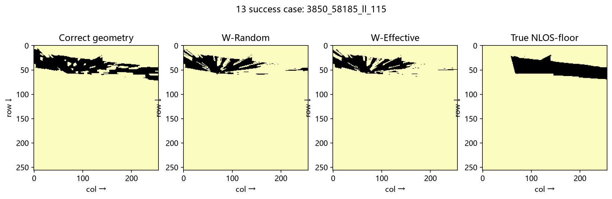

### 失败案例

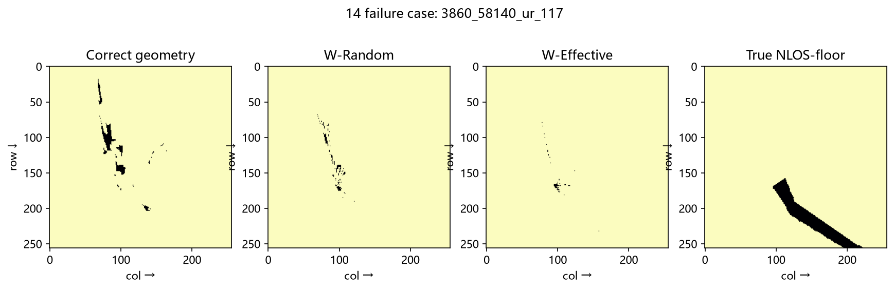

P0只证明在该评价定义下高度有信息，不能据此推断VLM会用好高度或RadioMap一定改善。[返回本组目录](../README.md)。

[返回实验总览](../../README.md)
