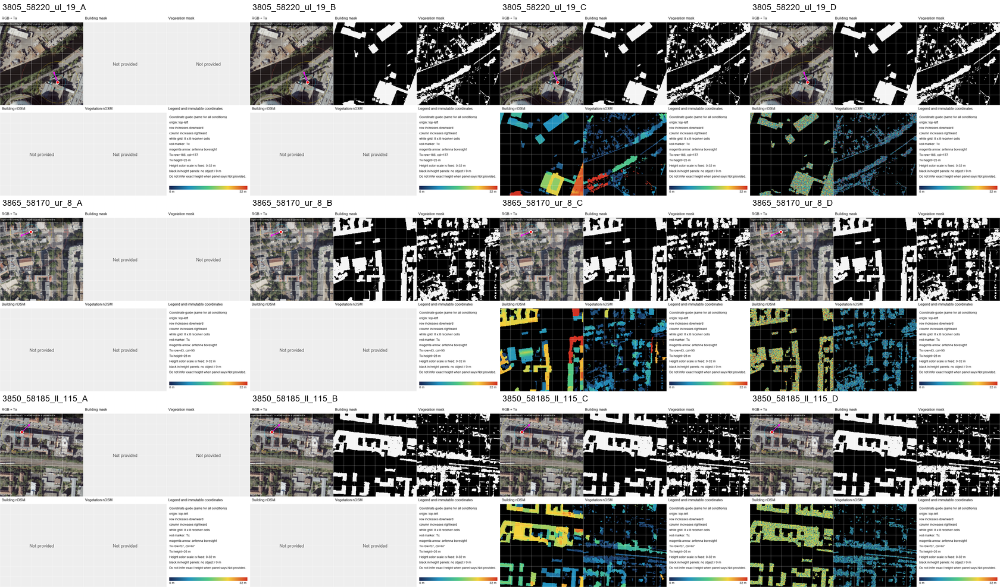
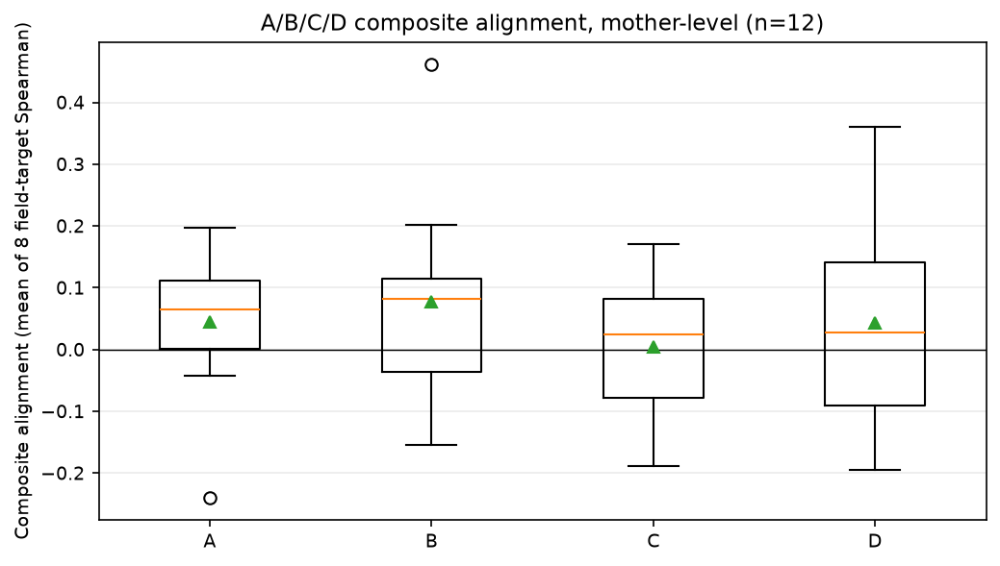
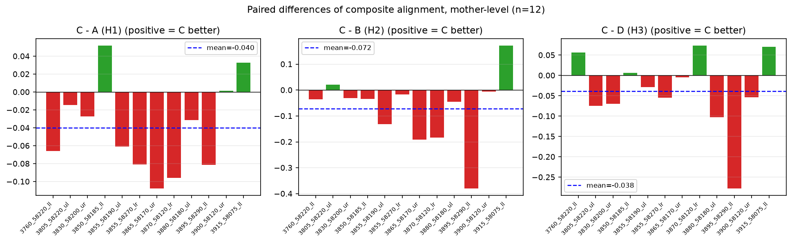
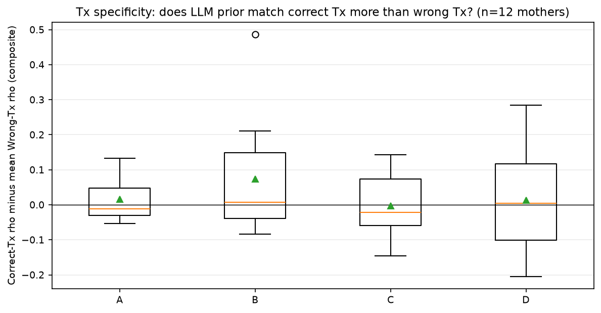
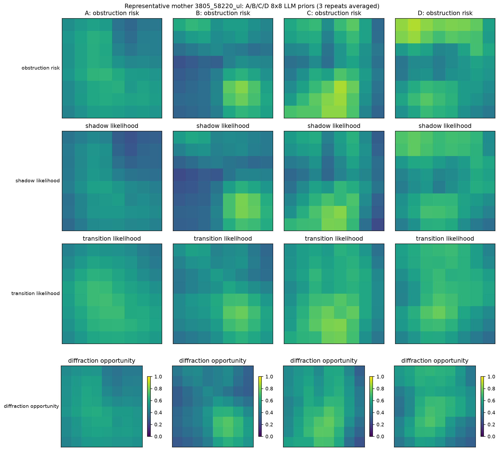
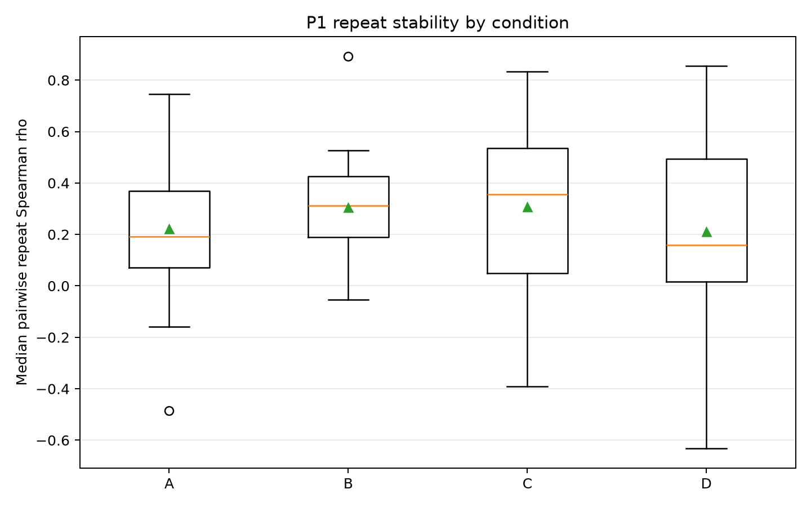
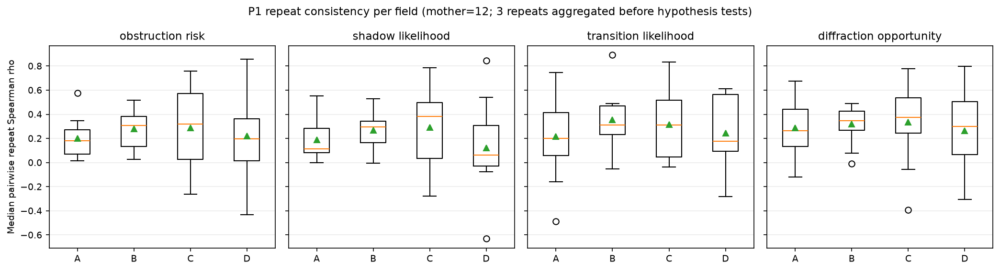
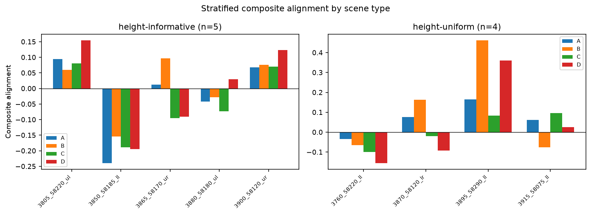

# P1：正确与错误高度

在P0之后，检验把正确高度交给模型是否改善8×8 Tx条件传播判断。12母图、每图1个Tx，4条件各3次回答，共144份有效输出；先逐格平均重复回答，再以母图为统计单位。

A为RGB＋Tx；B在A上增加正确二维建筑/植被掩膜；C在B上增加正确nDSM；D在B上增加错误高度。正确高度C没有稳定优于A/B/D，同图重复输出也存在波动，尚不能把结果唯一归因于高度使用或某个推理机制。

## 结果图片

### 四条件输入预览

### 四条件总体对齐

### 逐母图主比较：C减D、A、B

### Correct-Tx与Wrong-Tx对照

### 代表母图热力图

### 重复稳定性

### 分字段重复一致性

### 分层对齐结果

12个母场景是独立单位，144次回答不是144个独立场景；本批没有test泛化结果。[返回本组目录](../README.md)。

[返回实验总览](../../README.md)
