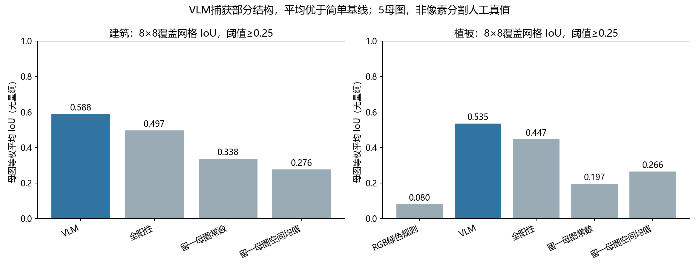
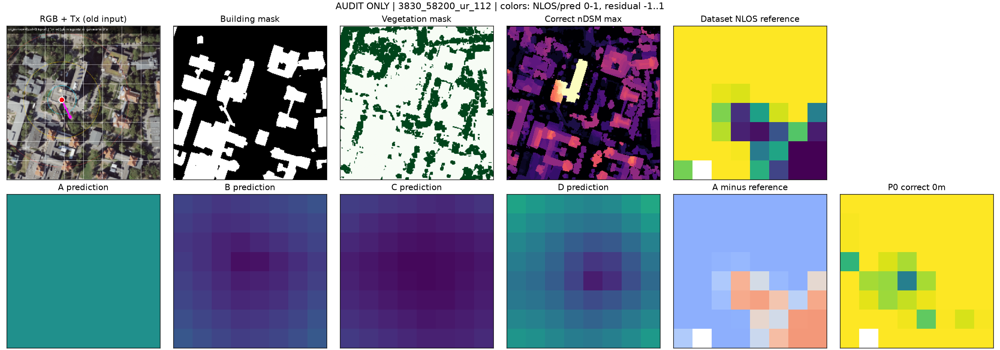
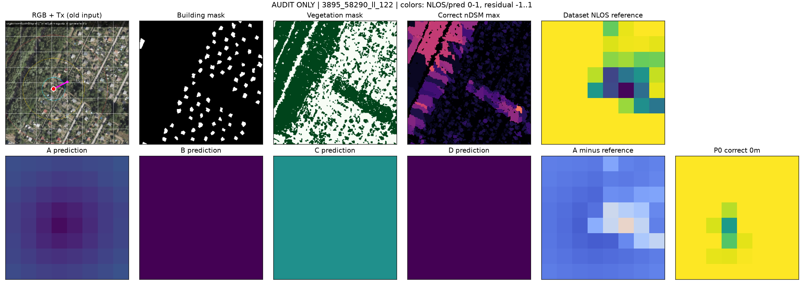

# 分层能力测试

分别诊断L0格式遵循、L1建筑/植被感知、L2 Tx坐标定位与L3传播判断。

L0为25/25；L0–L2合计70个唯一development请求，首次严格有效68/70，72次网络尝试后最终70/70。L1具有部分代理一致性；L2网格定位32/40，工具基线40/40。L3旧pilot仅4母图、32份回答，未显示正确高度的稳定优势，不能作为正式泛化结论。

## 结果图片

### L1建筑与植被代理一致性

### L3传播判断案例一

### L3传播判断案例二：低NLOS常数反例

感知代理一致性、坐标定位与传播任务回答不同问题。图中development和pilot结果不代表新场景确认。[返回本组目录](../README.md)。

[返回实验总览](../../README.md)
