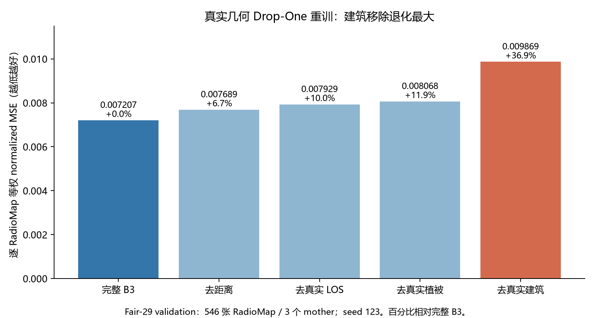

# 04 几何通道消融

从完整B3中分别移除建筑、植被、LOS或距离，并以相同划分、seed123和预算重训。评价为3个验证母图、546张RadioMap等权归一化MSE。

完整B3为0.007207；去距离0.007689，去LOS 0.007929，去植被0.008068，去建筑0.009869。去建筑退化约36.9%，在本批对照中最大，因此后续优先尝试恢复建筑。

## 结果图片

### Drop-One几何通道消融

这里是移除通道后重训，与固定模型的输入破坏实验不同。结果仅来自一个训练seed、3个独立验证母场景，不能作为普适物理重要性排序。

[返回实验总览](../README.md)
