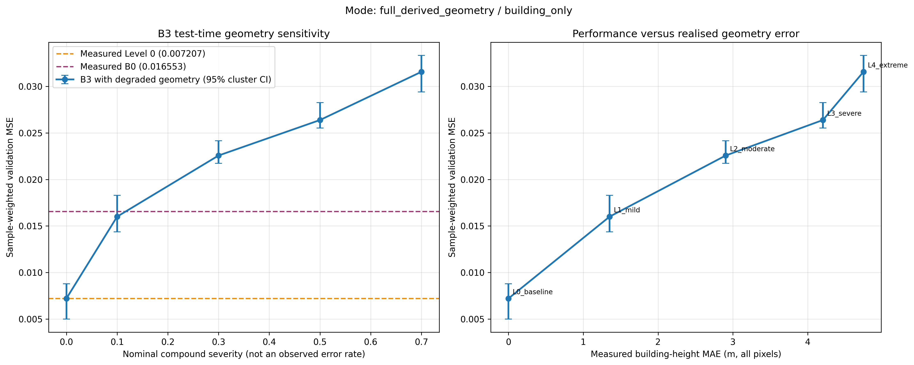
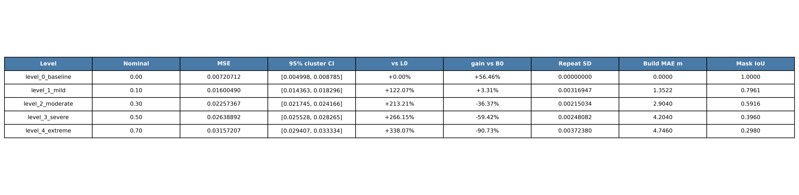

# 05 错误几何退化

固定真实几何训练的B3，联合改变建筑高度、边界、漏检/误检，并由退化建筑重新生成LOS，检查模型对复合输入变化的敏感性。

3个验证母图、546张RadioMap，Level 0评一次、Level 1–4各三次重复，共13次评价。Level 0 MSE为0.007207；Level 1为0.016005，已接近B0的0.0165535；Level 2–4继续升至0.022574、0.026389和0.031572。

## 结果图片

### Level 0–4几何退化曲线

### 各退化等级的结果表

nominal severity只表示合成复合压力等级。Level 1同时改变建筑support、边界、数值高度和派生LOS，不能把损害单独归因于1.352m高度MAE，也不能据此推断使用估计几何重训后一定失败。

[返回实验总览](../README.md)
