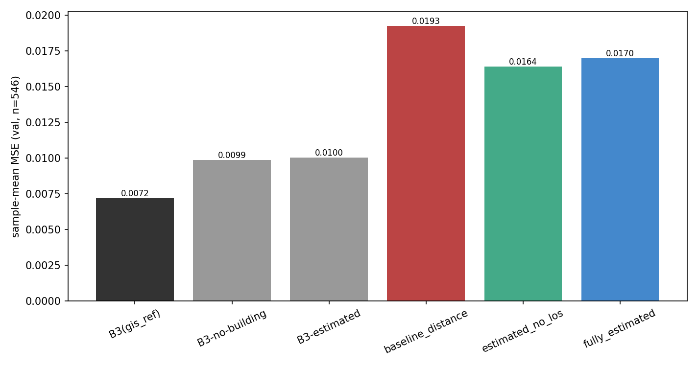
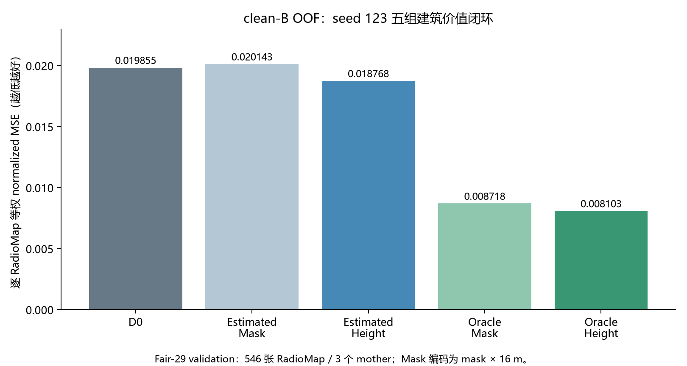
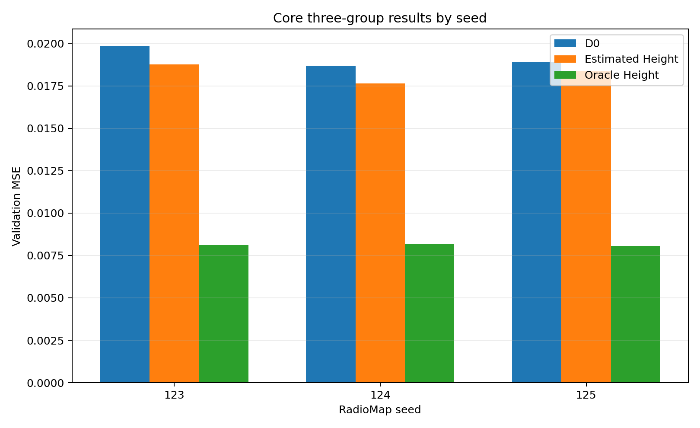
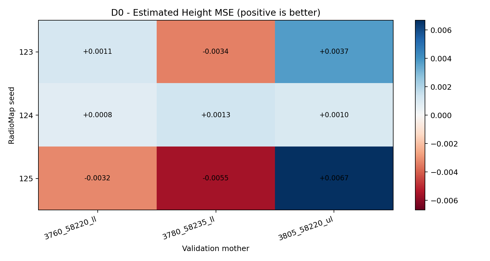
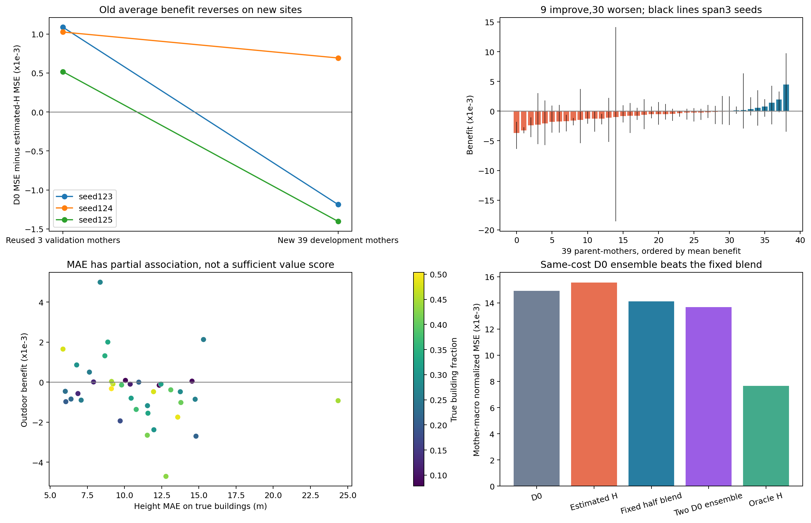
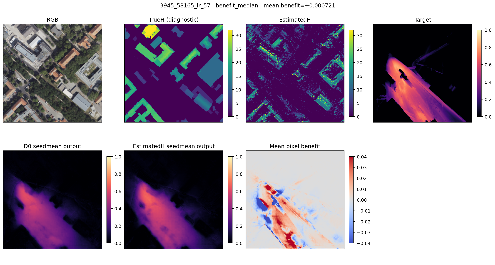
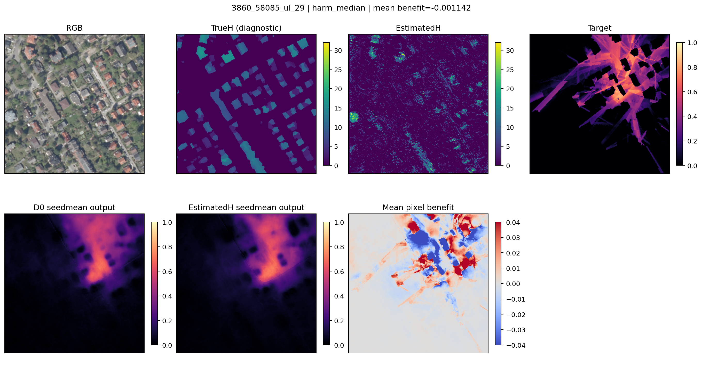

# 06 估计建筑闭环

检验RGB估计建筑在匹配训练和评测下能否改善RadioMap，并区分早期探索、clean OOF与新增地点验证。

当前结论是：旧地点clean OOF有小幅收益，新增39地点没有保持平均收益。D0为9通道匹配架构，建筑/植被/LOS置零、保留距离；它不同于5通道B0。Oracle Height只加入真实建筑，也不同于完整B3。

## 早期探索：Round1

旧3母图、546图，seed123的MSE由0.019257降到0.016402，约改善14.8%。这一阶段前端来源不确定，不能当作clean OOF证据。

## clean OOF：五组对照与三seed

旧3母图、546图，先逐图等权，再平均三seed损失：D0为0.019145，估计高度为0.018269，约改善4.58%；仅恢复约7.9%的Oracle gap，地点间差异较大。

### 五组对照

### 三seed主结果

### seed与母图改善热力图

## 新增39地点

39母图、930配置，以母图等权并平均三seed损失。D0为0.014909，估计高度为0.015546，平均恶化约4.27%，仅9/39地点受益。下面同时展示总体结果、改善与退化案例。

### 新增地点总体复验

### 改善地点的中位案例

### 退化地点的中位案例

三个阶段的前端来源、基线训练和评测地点不同，不是同一个性能进步序列；旧地点逐图等权与新地点母图等权也不能直接混比。新增地点仍来自同一城市，不能称跨城验证。

[返回实验总览](../README.md)
