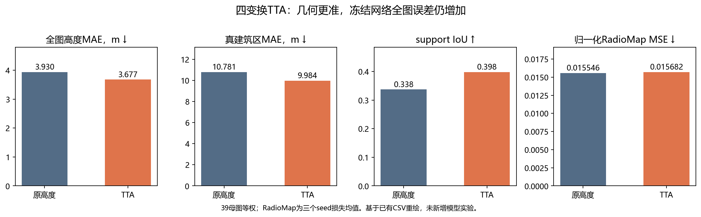
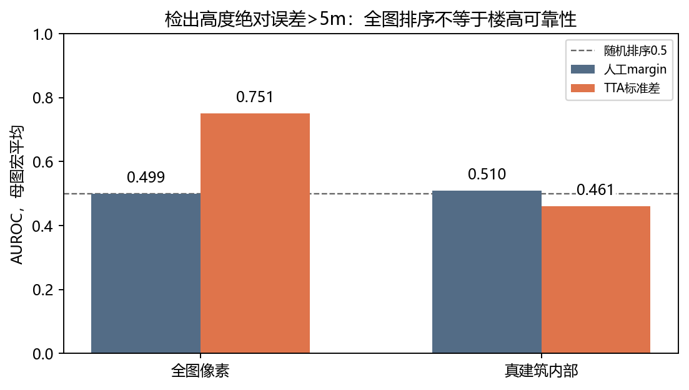

# 07 TTA几何改进

在同城39母图、930配置上，将原图、水平翻转、垂直翻转、180度旋转的高度预测逆变换对齐后平均，再输入原冻结RadioMap网络。

全图高度MAE由3.930m降至3.677m，真建筑区由10.781m降至9.984m，support IoU由0.338升至0.398；RadioMap全图MSE却由0.015546升至0.015682。几何更准没有自动转化为当前冻结网络的全图收益。

## 结果图片

### TTA几何精度与RadioMap任务表现

### TTA波动与像素风险排序

任务数值是母图等权、三seed损失均值，并非预测集成。TTA标准差对大于5m误差的AUROC为全图0.751、真建筑内部0.461；不能据全图排序推断已能判断楼高数值错误。这里没有用TTA高度重新训练下游网络。

[返回实验总览](../README.md)
