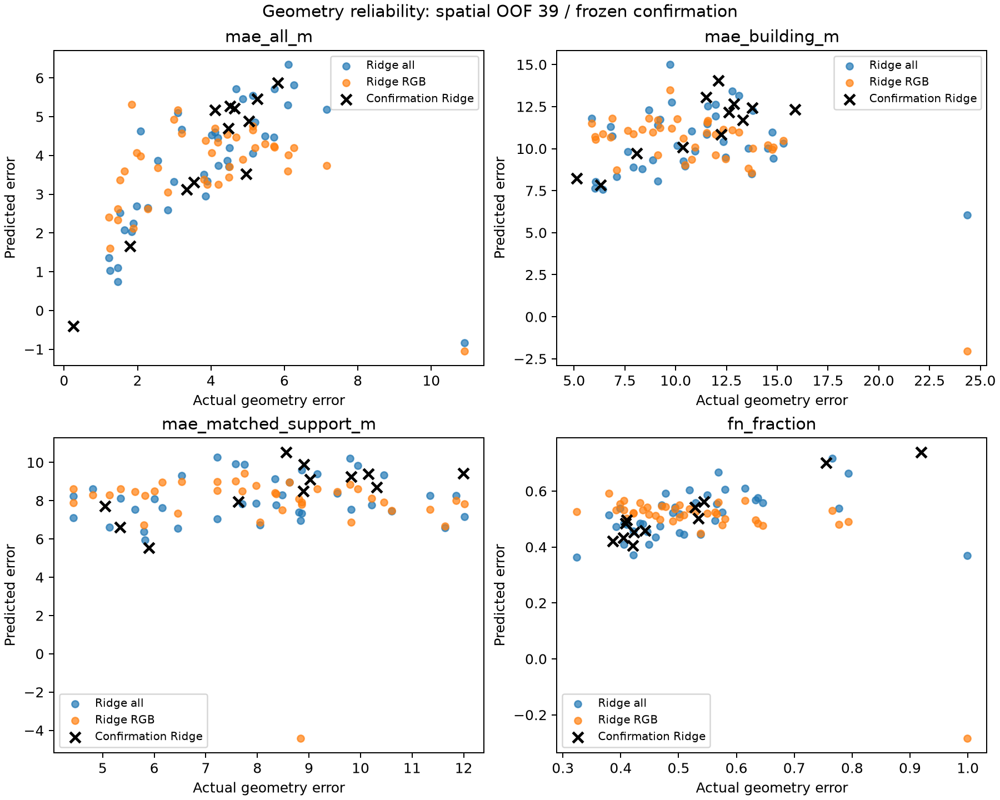
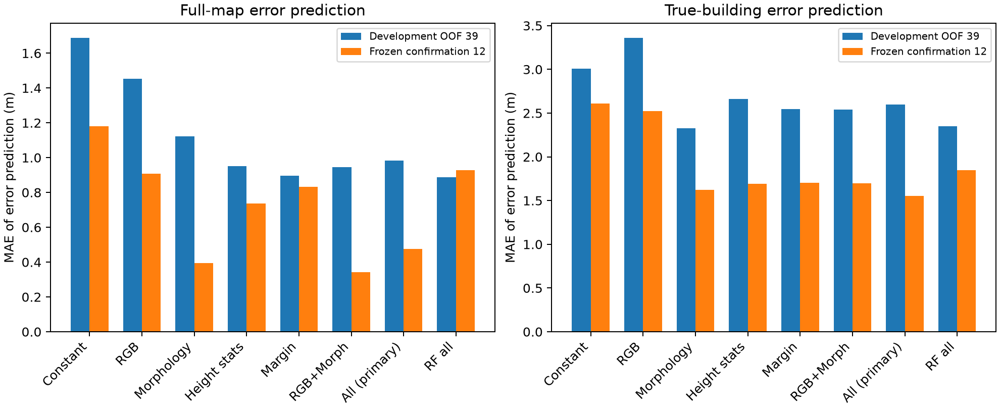
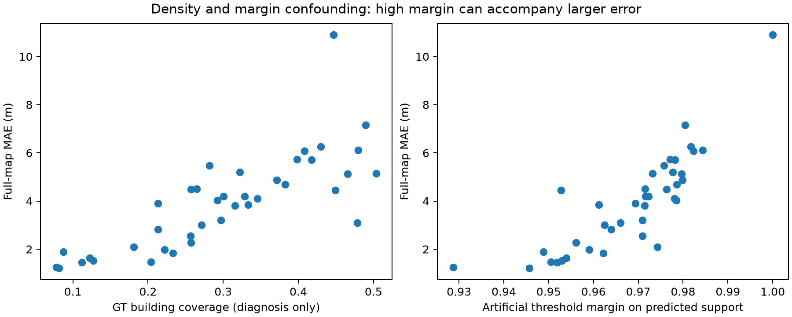
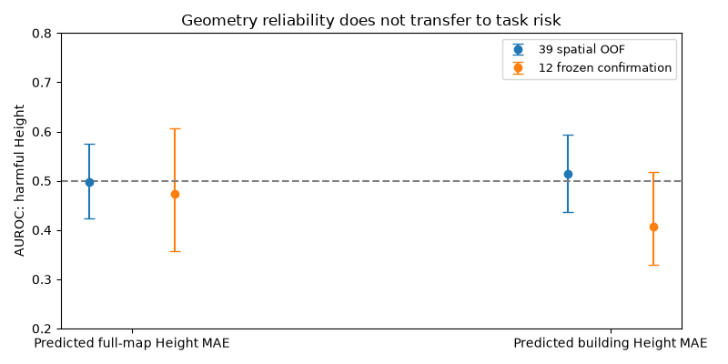
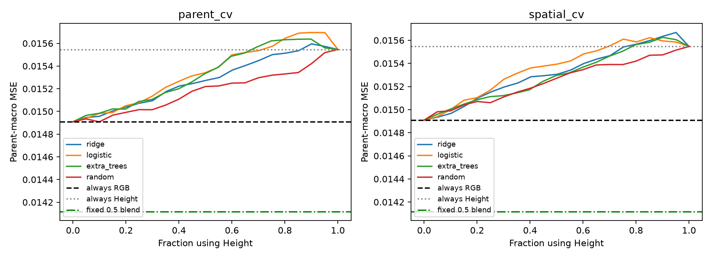
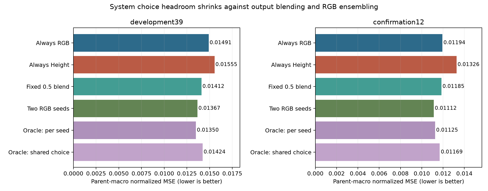
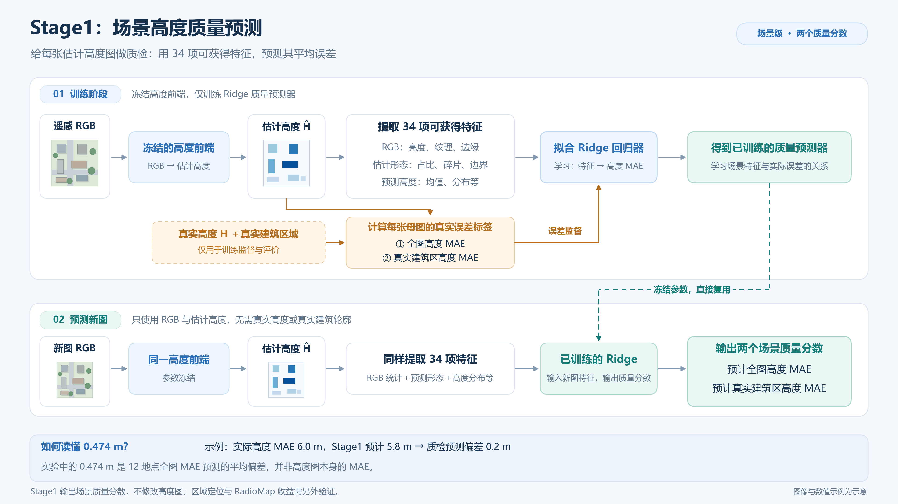
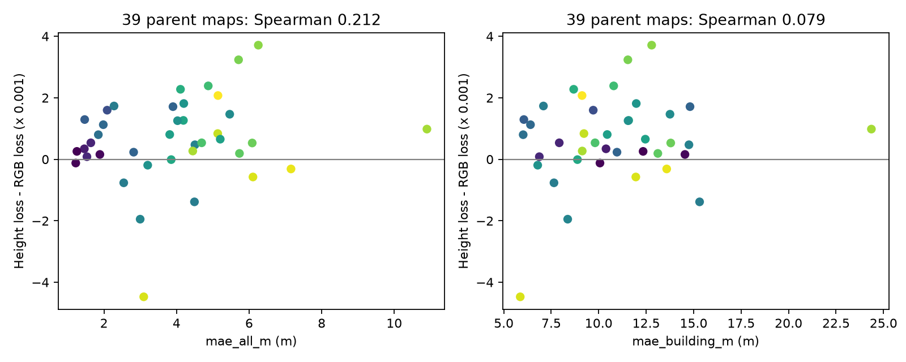

# 08 几何风险预测

Stage1预测场景的几何误差，Stage2预测使用估计高度相对D0的任务风险。开发39母图，另有12母图固定规则后评价，均为Berlin。

Stage1能预测部分几何错误：12地点全图高度MAE这个数的预测MAE为0.474m，常数基线1.180m。这不是高度前端自身达到0.474m精度。几何风险没有稳定桥接到任务风险；主Stage2在12地点选择后的MSE为0.012165，仍差于始终D0的0.011936。

## 结果图片

### Stage1几何误差预测

### Stage1特征族对照

### 覆盖率与人工margin诊断

### 几何风险到任务风险的桥接

### 任务风险与系统损失

### 强固定系统与Oracle参照

### Stage1训练与推理流程

### 文稿补充：高度误差与任务表现

gain通道纠正后的事后复评仍未超过D0，不能算独立确认。区域Oracle与实际融合处理的是RadioMap输出，没有修改高度图；实际Ridge/ExtraTrees融合未超过双D0普通集成。样本属于已经使用的同城研究资产。

[返回实验总览](../README.md)
