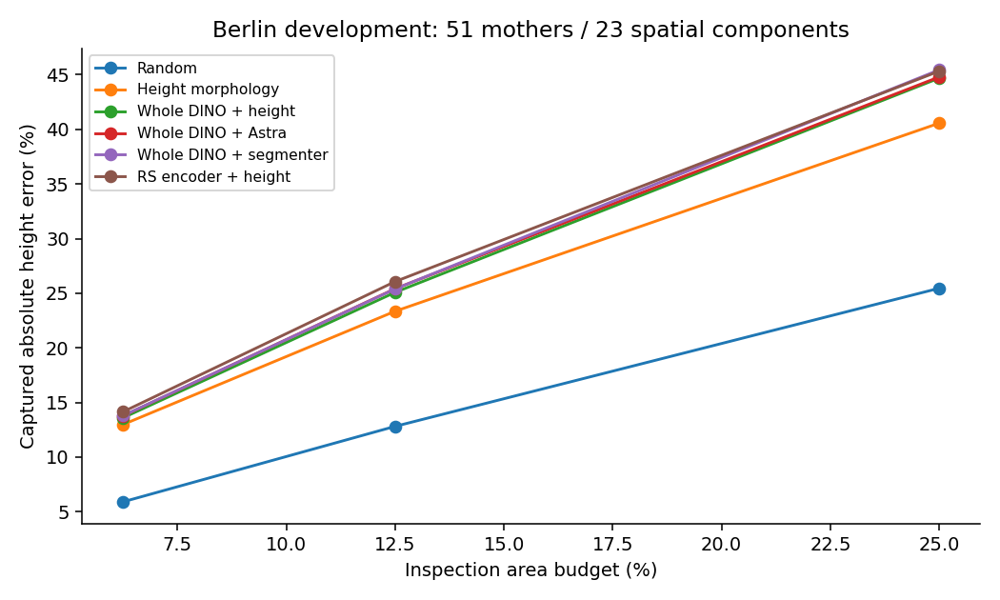
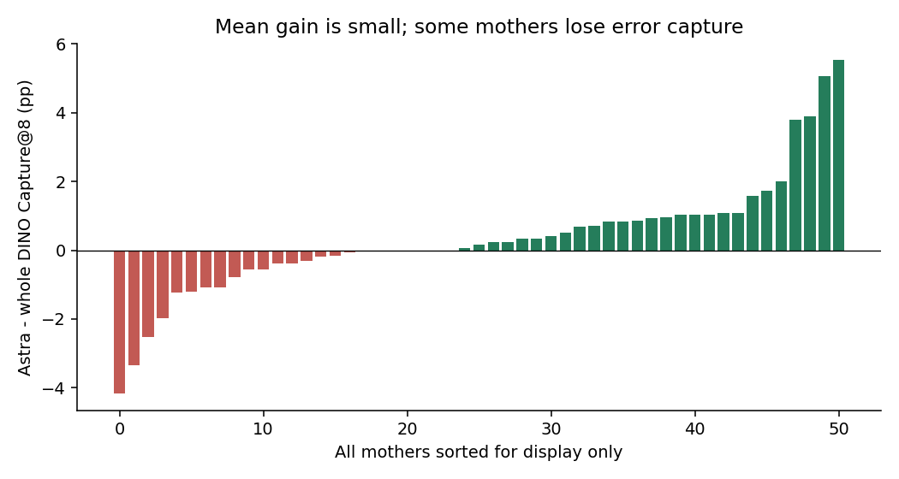
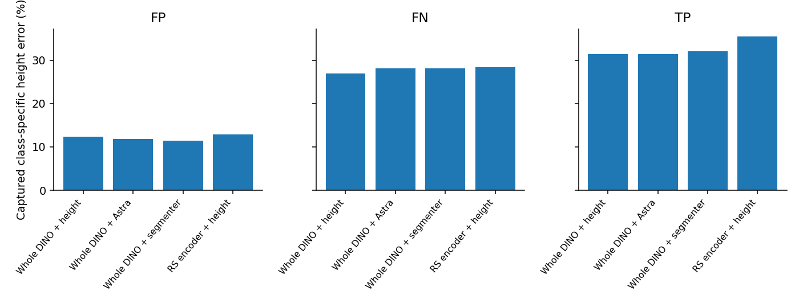
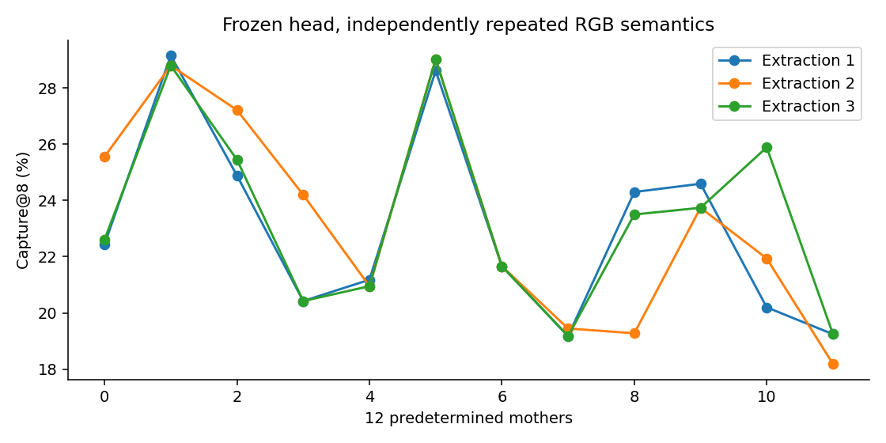
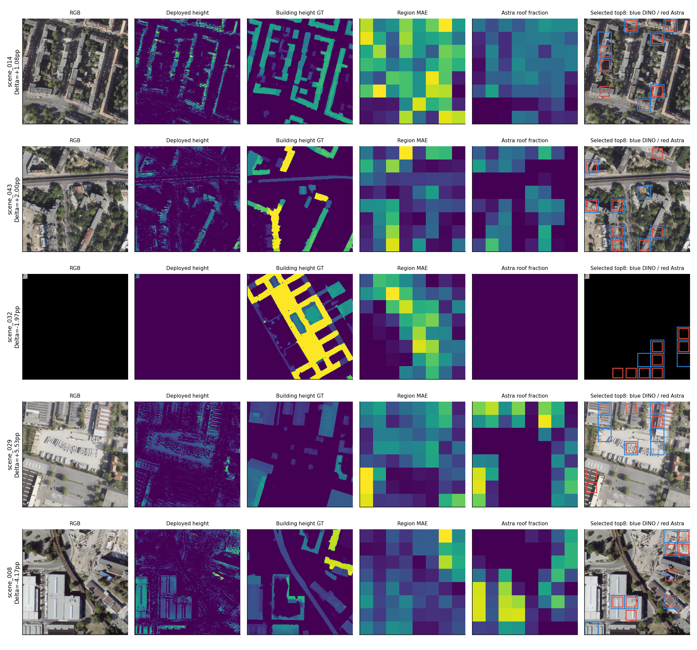
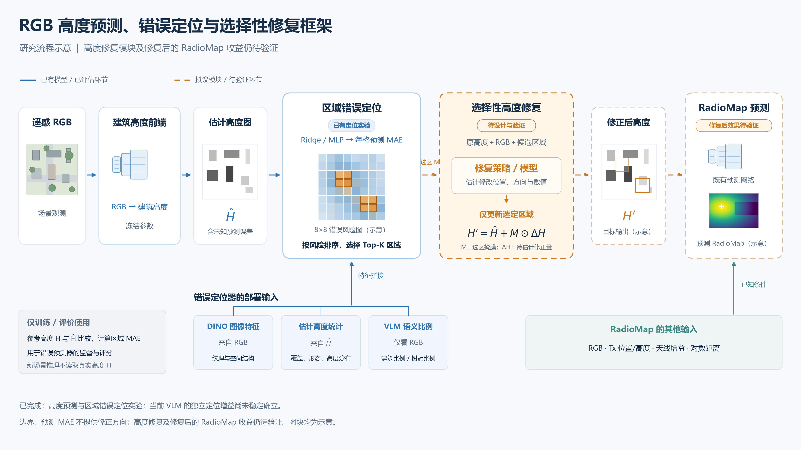

# 09 Astra错误定位

在51张Berlin高度图、23个空间组件上，将每图分成8×8格并选8格检查。Capture@8表示选中12.5%面积覆盖了多少绝对高度误差，不表示已经修复了这些误差。

修正后的真整图DINO＋高度Ridge为25.08%，加入Astra为25.41%，增量0.331个百分点，区间跨零；MLP为25.33%到25.23%，普通分割对照为26.08%。当前没有建立Astra在强视觉与普通分割之外的稳定总误差定位增量。

## 结果图片

### 检查预算与误差捕获

### 全部地点的差异

### FP、FN与TP错误类型

### 重复提取稳定性

### 随机与极端案例

### 错误定位与拟议修复流程

采用修正后的真整图特征口径；旧crop特征误标结果不作为主结论。流程图中的橙色虚线是尚未验证的修复设想，本轮没有执行自动高度修复或新的RF闭环。

[返回实验总览](../README.md)
