> 组会记录：保留原稿正文，仅整理链接。当前结果口径与实验说明以[实验总览](../README.md)及九组实验README为准。

## 研究背景与问题

## LLM是否具备从视觉场景中提取可用于物理传播预测的空间语义？

**核心问题**：

1. LLM 语义能不能真正改善下游 Radio Map 预测？
2. 如果不能，原因是网络没用上、被几何覆盖，还是语义本身就不对？
3. 如果是语义不对，原因是 RGB 缺三维信息，还是 GPT 自己的空间理解和传播推理有问题？

**数据**：Fair-29 数据集，共 29 张 mother map、5005 张 Radio Map。

| 划分  | Mother 数 | Radio Map 数 |
| --- | -------- | ----------- |
| 训练  | 23       | 3964        |
| 验证  | 3        | 546         |
| 测试  | 3        | 495         |

## 2 第一部分：下游网络中，LLM 语义有没有用？

### 2.1 四个模型

             无LLM       有LLM

无几何            B0               B0+LLM

有几何            B3                   B4

| 模型          | 空间输入                                   | LLM 条件                   | 回答的问题                                    |
| ----------- | -------------------------------------- | ------------------------ | ---------------------------------------- |
| B0          | RGB、Tx 位置/高度、天线增益（5 通道）                | 无                        | 没有显式几何时的基础性能 |
| B0+LLM-FiLM | 同 B0                                   | 13 项 mother 级类别，瓶颈层 FiLM | 语义本身有没有绝对信息量                             |
| B3          | B0 + 建筑/植被 nDSM、log-distance、LOS（9 通道） | 无                        | 显式几何能带来多少提升                              |
| B4-FiLM-Cat | 同 B3                                   | 同 B0+LLM                 | 有了强几何后，语义还有没有增量                          |

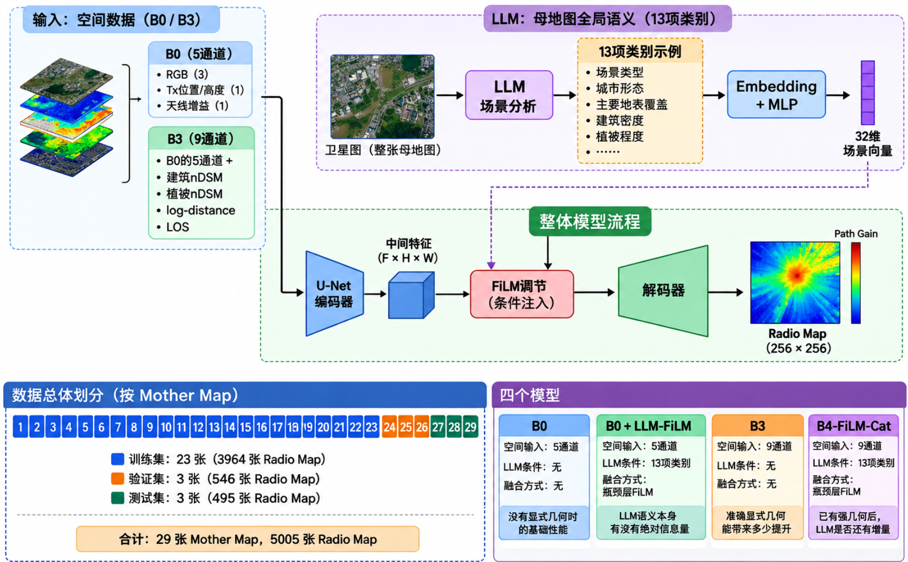

13 项语义是对**整张 mother map 的一份全局描述**，包括场景类型、城市形态、建筑密度、遮挡强度、绕射/反射倾向、穿透风险等。

同一 mother 下的所有 Tx 共用同一份语义。

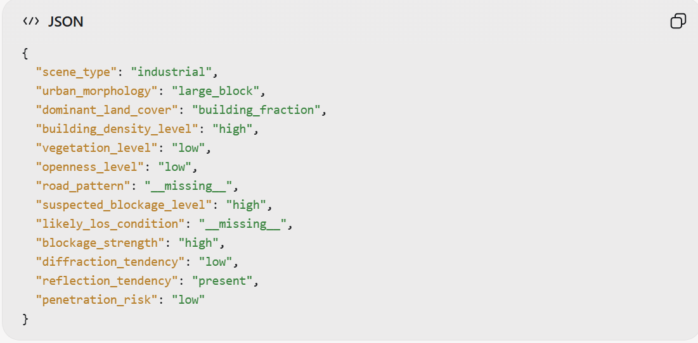    

### 2.2 主对照：几何很有效，LLM 没有增益

| 模型          | best val MSE  | 结论             |
| ----------- | ------------- | -------------- |
| B0          | 0.0164985     | 基线             |
| **B3**      | **0.0071808** | 比 B0 降低约 56.5% |
| B4-FiLM-Cat | 0.0072858     | 比 B3 差约 1.46%  |

##### B4 失败有三种可能解释，接下来逐一排除：

① 网络没读语义；

② B3 几何太强，遮住了语义；

③ 数据量充足时先验体现不出来。

### 2.3 排除解释①：Checkpoint 测试时置换

固定训练好的 checkpoint，只在推理时替换语义输入：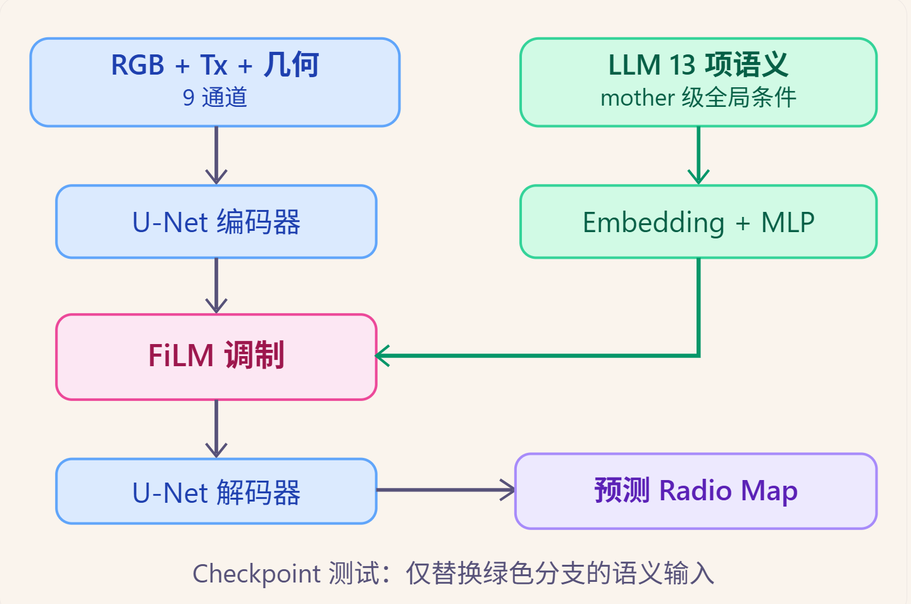

| 条件                           | MSE       | 相对 B4-Normal |
| ---------------------------- | --------- | ------------ |
| B4 Normal（正确语义）              | 0.007397  | 0            |
| LLM-Zero（把语义输入替换为零值条件）       | 0.007063  | −0.000334    |
| LLM-Train-Mean（使用训练集语义条件的均值） | 0.007023  | −0.000374    |
| LLM-Shuffle（打乱语义与场景之间的对应关系）  | ≈0.007213 | ≈−0.000184   |

##### 发现一：FiLM 条件通路确实影响预测。

四种输入得到了不同的测试 MSE。

由于 Checkpoint 是固定的，改变的是语义条件，因此可以说明模型的预测表现对语义输入有响应。

###### 发现二：但**正确语义是四种条件里最差的**

置零或换成均值反而更好。说明语义被用上了，但起的是负作用，更像噪声、冗余或条件偏置。

### 2.4 排除解释②：B0+LLM 最小对照

把完全相同的语义和 FiLM 接到**没有显式几何的 B0** 上：

| 条件                | MSE           | 相对 B0  |
| ----------------- | ------------- | ------ |
| **B0**            | **0.0165535** | 基线     |
| B0+LLM Correct    | 0.0184403     | +11.4% |
| B0+LLM Zero       | 0.0175009     | +5.7%  |
| B0+LLM Mean       | 0.0169749     | +2.5%  |
| B0+LLM Shuffle 均值 | 0.0183740     | +11.0% |
| B3                | 0.0072071     | −56.5% |

#### 发现：

1. B0+LLM 的正确语义比不使用 LLM 的 B0 差。

2. 正确语义仍然不如 Zero 和 Mean。

3. 正确语义与 Shuffle 表现十分接近。
   
   ##### 从当前实验结果来看，“几何太强”不是 B4 失败的充分解释。

### 2.5 排除解释③：小数据实验

10%/25% 是嵌套子集，数据划分、seed 和优化协议与 100% 实验相同，

统一以 19,820 个优化步为上限，并使用 early stopping，排除欠拟合的影响。

| 数据比例 | B0      | B0+LLM  | B3      | B0+LLM 相对 B0 |
| ---- | ------- | ------- | ------- | ------------ |
| 10%  | 0.01862 | 0.02074 | 0.00808 | +11.4%       |
| 25%  | 0.01693 | 0.02103 | 0.00718 | +24.3%       |
| 100% | 0.01655 | 0.01844 | 0.00721 | +11.4%       |

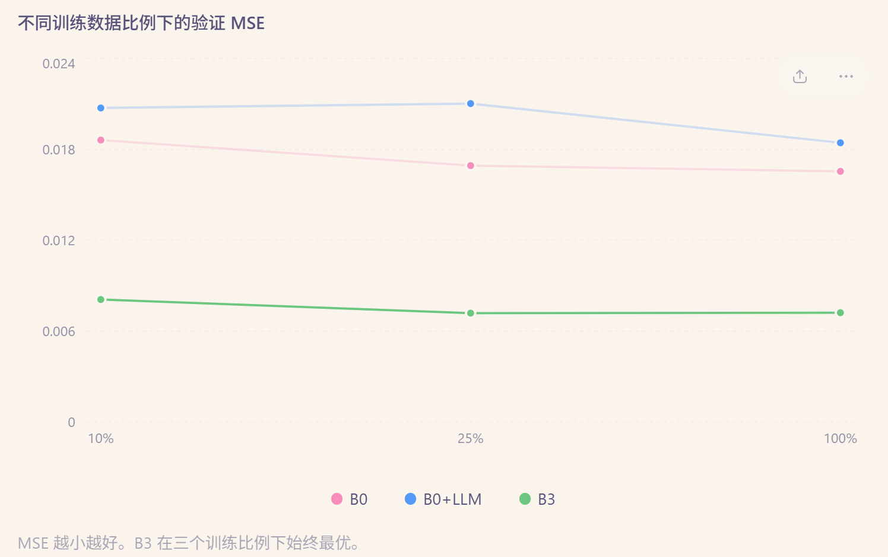

* 其中：
  
  * 10% 数据时，B0+LLM 比 B0 差 11.4%。
  
  * 25% 数据时，B0+LLM 比 B0 差 24.3%。
  
  * 100% 数据时，B0+LLM 比 B0 差 11.4%。
  
  也就是说：
  即便缩小训练数据量，LLM 语义也没有表现出我们期待的先验优势。
  更重要的是，B3 在数据只有 10% 时仍然明显优于 B0 和 B0+LLM。
  这说明，在当前实验设置中，显式几何比这 13 项全局语义更有效，哪怕训练数据有限也是如此。

### 2.6 补充：是否只在局部区域有效？

##### 2.6.1 逐 mother 的 B4−B3 MSE：

−0.000140 / −0.000070 / **+0.000569**。两张略好，被第三张的明显变差抵消。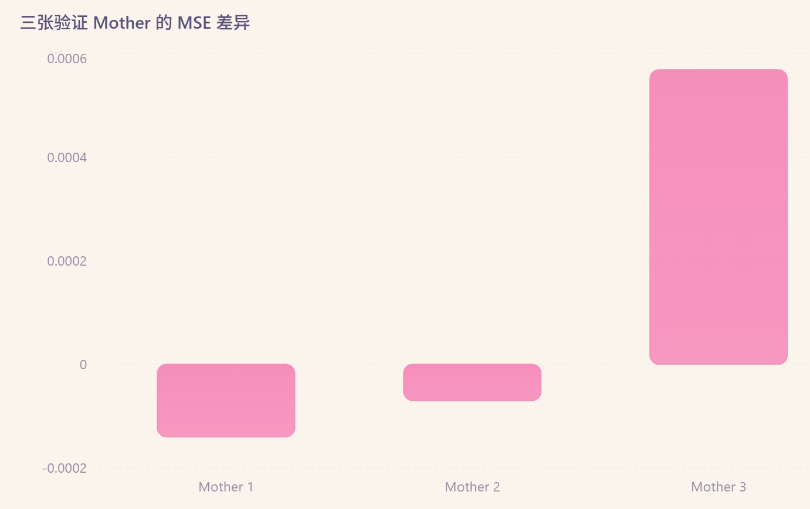

#### 2.6.2 不同区域

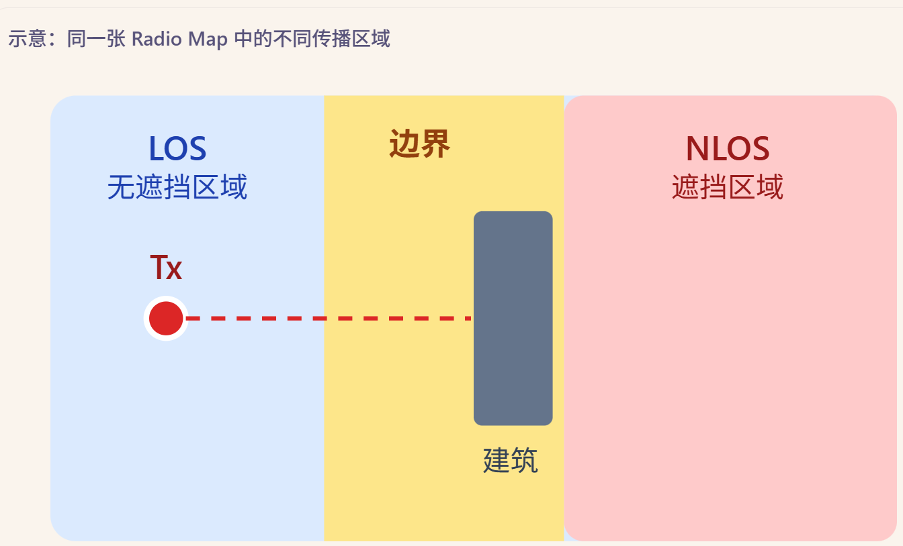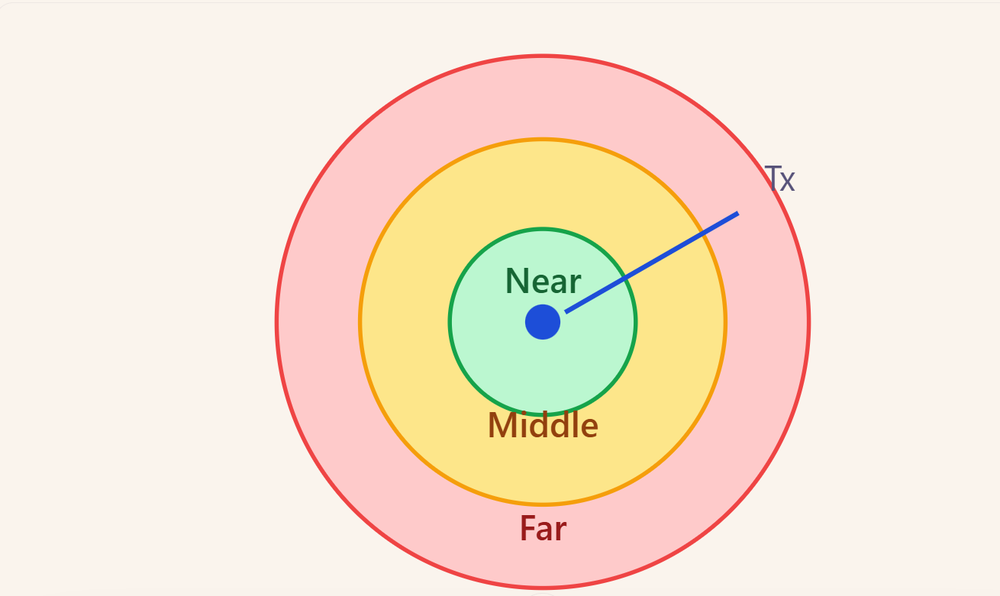

| 区域分解                | B4 相对 B3          | B4-Shuffle 对比      | 判断               |
| ------------------- | ----------------- | ------------------ | ---------------- |
| LOS / 边界带           | 略好                | Shuffle 在边界带同样好或更好 | 不能归因于语义          |
| NLOS                | 更差                | Shuffle 更好         | —                |
| Near / Middle / Far | 三组都不如 B3，远距离退化更明显 | —                  | 没有"语义只在远距离有效"的证据 |

→ 局部改善**在不同区域之间不一致**，而且错误语义经常同样好。不能把这些局部变化归因于正确语义。

### 第一部分小结

> 显式几何非常有效。B4 没有增益，不是因为网络没读语义、不是被几何遮蔽，也不是数据太多。**问题出在语义内容本身**：它过于全局、没有空间位置和 Tx 特异性，或者类别与真实传播的关系不稳定。
> 
> → 下一步要直接检查语义本身：**让 GPT 输出带空间位置、随 Tx 变化的语义，看它是否和真实传播对得上。**

### 这些语义存在两个潜在缺陷。

##### 第一，没有空间位置。

例如“建筑密度高”不能告诉模型哪一个具体区域存在遮挡。

##### 第二，没有 Tx 特异性。

同一张 mother map 里，不同 Tx 位置共享同一份语义。

而真实无线传播高度依赖 Tx 的位置。

所以接下来设计了新的实验：让 GPT 不再输出笼统类别，而是输出空间化、Tx-conditioned 的传播先验。 

# 3 第二部分：LLM是否学习了传播相关空间结构？

### 3.1 实验设计

* 输入：256×256 卫星图 + Tx 标记。GPT-5.5 输出 5 张 **8×8** 的 Tx-conditioned 空间先验。
* 真值：Path Gain 和 LOS 按每 32×32 像素汇总成同位置的 8×8 网格，逐格比较。
* 规模：26 张 mother × 3 个 Tx = 78 份先验。统计单位是 26 张 mother。
* 检验两层：**场景相关性**（与 Shuffle 对照比）和 **Tx 特异性**（与 Wrong-Tx 对照比）。

### 3.2 结果

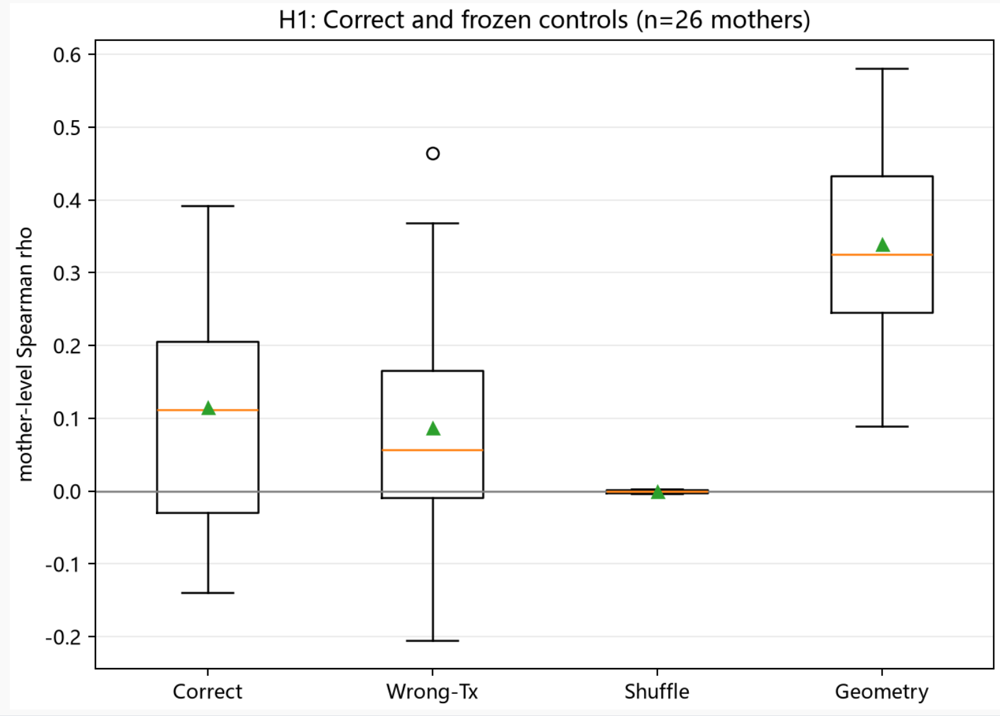

* `propagation_transition`（GPT 认为传播容易突变的区域）与真实 Path Gain 梯度存在**弱但非随机**的相关，显著不同于 Shuffle。
  
  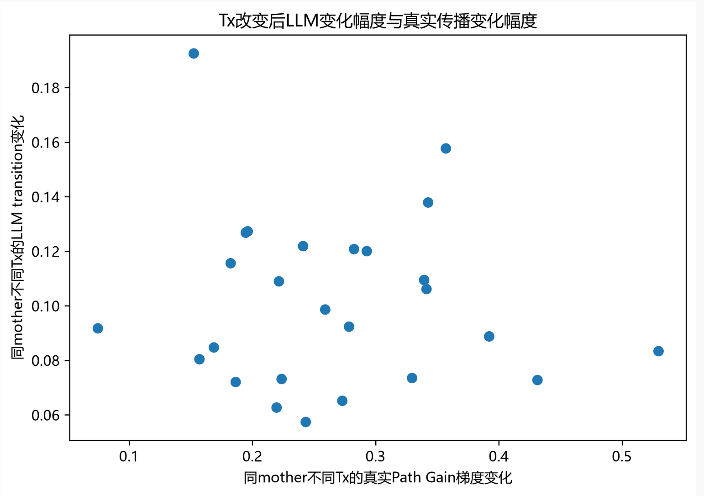
  
  #### 结论1：GPT不是完全没有空间理解能力
  
  #### 结论2：GPT没有证明自己理解Tx条件传播
  
  #### 结论3：显式几何明显优于LLM空间先验

### ✅ 第二部分小结

> GPT 能从图像中识别出少量与传播有关的场景结构，这部分很可能来自可见的建筑几何。但它**没有表现出随 Tx 变化的增量**：Tx 换了位置，输出并没有跟着真实传播一起变。
> 
> → 新问题：**GPT 为什么判断错？** 

## 第三部分：错误来源是缺三维信息，还是 GPT 推理不足？

> **疑问一**：建筑高度本身到底有没有传播信息？  
> **疑问二**：把正确高度交给 GPT，它会不会变好？

### 4.2 疑问一 →P0 几何正对照：高度位置可以被检测

比较：

* 正确 nDSM 高度；
* 保持高度分布不变、但打乱高度空间位置的错误 nDSM。

如果连几何算法都无法区分正确和错误高度，说明评价方法本身不敏感，也无法判断 GPT 是否利用了高度。

实验中：

* 接收高度与真实 LOS 定义保持一致，设置为 0 m；
* 错误高度只改变空间位置，不改变高度集合；
* 在 26 张 mother map 上进行配对统计。

**结果**：

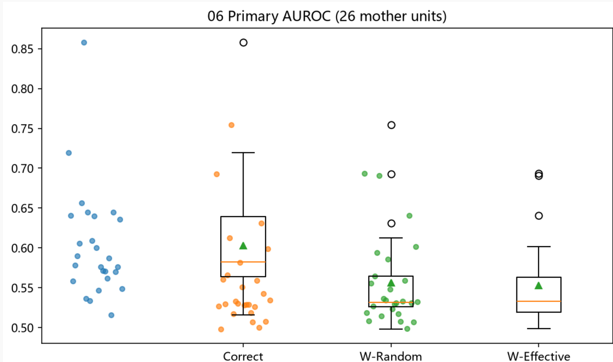

##### **P0 强通过**：正确高度确实包含 LOS 和传播信息，而且当前评价链路能识别高度的空间位置是否正确。

### 4.3 疑问二 → P1：把正确高度交给 GPT

在同一批 12 个 Tx 上设四种严格配对的输入，每种重复 3 次，共 **144 份输出**。

| 组   | 输入            | 预期（如果 GPT 会用高度）   |
| --- | ------------- | ----------------- |
| A   | RGB + Tx      | —                 |
| B   | A + 二维建筑/植被掩膜 | —                 |
| C   | A + 正确 nDSM   | 应稳定优于 A、B，并明显优于 D |
| D   | A + 错误 nDSM   | —                 |

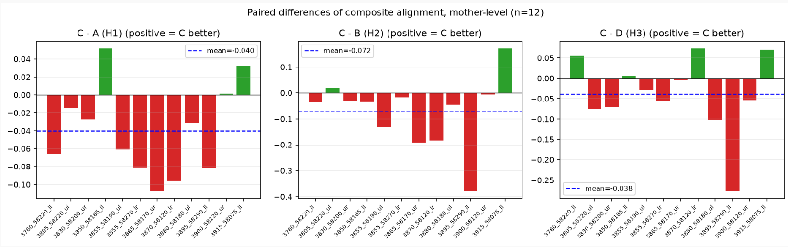

**结果**：正确高度 C **没有稳定优于** A、B，也没有稳定优于错误高度 D。

### 结论：

> **P0 说明三维高度本身有用；P1 说明把正确高度交给当前 GPT，传播语义并没有稳定改善。**  
> 既然评价链路已被证明灵敏，C 不优于 D 就只能解释为：**GPT 没有把高度、Tx 位置和传播路径结合成正确的遮挡判断。**
> 
> → 新问题：**GPT 的能力具体卡在哪一层？** 

# 第四部分：GPT 先验能力边界的分层测试

用逐层递进的任务定位能力断点。
    L0 接口/格式遵循 → L1 场景感知 → L2 Tx 坐标接地 

| 层级               | 测试目标                 | 实验设置                                   | 结果                                                      | 结论                               |
| ---------------- | -------------------- | -------------------------------------- | ------------------------------------------------------- | -------------------------------- |
| **L0 格式能力**      | 是否能够稳定输出结构化结果        | 70 条 development 请求，测试 JSON/schema 合规性 | **70/70**                                               | 格式协议基本稳定，但仅说明输出约束能力              |
| **L1 场景视觉理解**    | 是否能从 RGB 理解建筑/植被空间结构 | 预测建筑、植被区域，与 nDSM 代理比较                  | 建筑 IoU **0.588**；植被 IoU **0.535**；全阳性指标 **0.497/0.447** | 能捕获部分场景结构，但跨场景稳定性有限；无人工 RGB 真值验证 |
| **L2 Tx 空间定位能力** | 是否能从图像理解发射机位置        | 8×8 网格定位 Tx；同时测试红点工具辅助                 | 网格正确 **32/40**；工具定位 **40/40**                           | 模型能够响应 Tx 信息，但视觉定位精度低于显式坐标工具     |

### 能力断点

| 能力层     | 状态                |
| ------- | ----------------- |
| 格式/接口   | ✅ 稳定              |
| 二维场景感知  | △ 平均有优势，场景间不稳定    |
| Tx 坐标接地 | ❌ 有反应但精度不足，不如简单工具 |

这与前面各部分的结论吻合：GPT 不是看不见场景，而是**定位不准，而且不会做随 Tx 变化的传播推理**。 

### 6. 证据链回顾

| 环节   | 实验                          | 结论                              |
| ---- | --------------------------- | ------------------------------- |
| 下游   | B0/B3/B4、置换、B0+LLM、小数据、误差分解 | 显式几何强有效；当前 LLM 语义没有可靠增量，问题在语义内容 |
| 语义对齐 | 8×8 空间语义 vs Path Gain/LOS   | 弱但非随机的场景相关；没有 Tx 特异性            |
| 错误归因 | 可视化 + P0-v2 + P1            | 高度有用、评价灵敏，但 GPT 用不上高度           |
| 能力边界 | L0–L2                       | 断点在坐标接地和随 Tx 变化的传播推理            |
