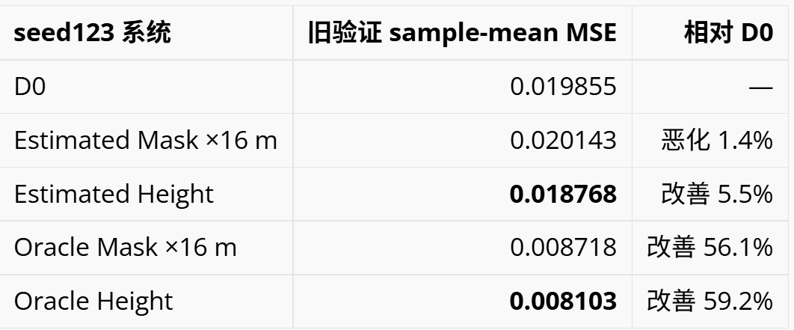
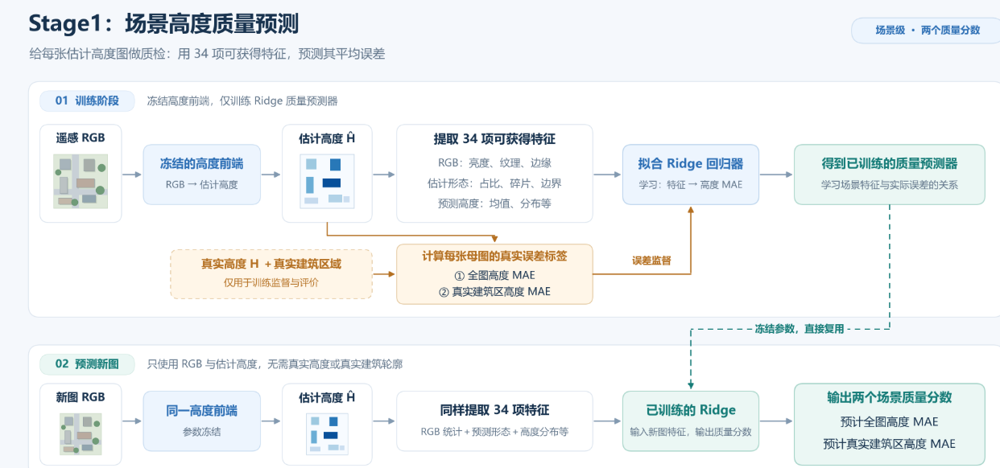
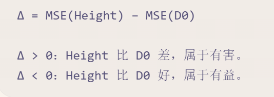
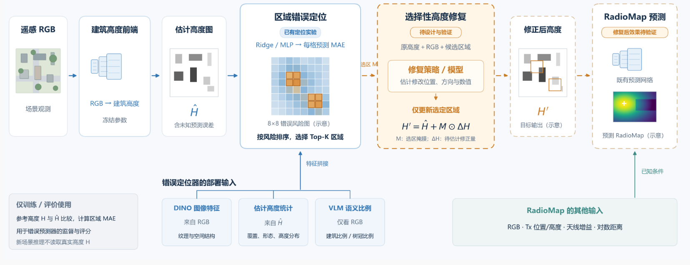
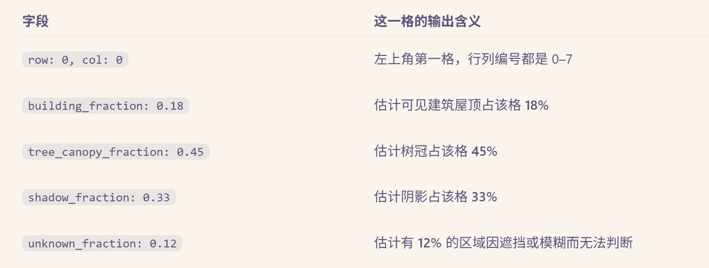

# 1 起点：真实几何值得恢复，优先恢复建筑

### 1.1 设计

对 B3 的距离、建筑高度、植被高度和真实 LOS 分别做 Drop-One 消融。

**如果模型从一开始就拿不到某类信息，其余输入能补偿多少？**

### 1.2 结果

为与逐 RadioMap 和逐 mother 分析保持一致，下表使用选中 checkpoint 在全部 546 张 validation RadioMap 上的 sample-mean MSE。

| 模型                                           | 移除的信息  | MSE          | 相对完整 B3    | 结论              |
| -------------------------------------------- | ------ | ------------:| ----------:| --------------- |
| B3                                           | 无      | **0.007207** | —          | 完整几何参考          |
| B3-no-distance                               | 距离图    | 0.007689     | +6.7%      | 距离有用，但其余输入可部分补偿 |
| B3-no-LOS                                    | 真实 LOS | 0.007929     | +10.0%     | LOS 有明确增益       |
| B3-no-vegetation | 真实植被高度 | 0.008068     | +11.9%     | 植被有明确增益         |
| B3-no-building                               | 真实建筑高度 | **0.009869** | **+36.9%** | 单项移除造成最大退化      |

---

# 2 错误几何会迅速吃掉收益

### 2.1 实验目的

固定已经使用真实几何训练好的 B3，在验证阶段逐步破坏建筑高度、轮廓、漏检和误检，

并由退化后的建筑重新计算 LOS，观察模型对错误几何的敏感性。

完整实验包含：

- 546 个验证 RadioMap；
- 3 个验证 mother；
- Level 0 一次；
- Level 1–4 各三个随机重复；
- 共 13 次评估、7098 条逐 RadioMap 记录；
- Level 0 与历史 B3 指标差 1.44×10⁻⁶，复现通过。

### 2.2 结果

| 等级      | nominal severity | 建筑 MAE (m) | mask IoU | MSE          | 相对 Level 0 | 相对本次 B0       |
| ------- | ----------------:| ----------:| --------:| ------------:| ----------:| -------------:|
| Level 0 | 0.00             | 0.000      | 1.000    | **0.007207** | —          | 优于 B0 56.46%  |
| Level 1 | 0.10             | 1.352      | 0.796    | **0.016005** | +122.07%   | 仅优于 B0 3.31%  |
| Level 2 | 0.30             | 2.904      | 0.592    | **0.022574** | +213.21%   | 比 B0 差 36.37% |
| Level 3 | 0.50             | 4.204      | 0.396    | **0.026389** | +266.15%   | 比 B0 差 59.42% |
| Level 4 | 0.70             | 4.746      | 0.298    | **0.031572** | +338.07%   | 比 B0 差 90.73% |

### 2.3 结论

- B3 对错误建筑和错误派生 LOS 很敏感。
- 轻度复合退化已基本抹去 B3 相对 B0 的优势。
- 错误几何可能比没有几何更糟。
- 这说明 B-estimated 必须在训练和验证阶段都使用估计建筑，不能把估计建筑直接替换进原 B3。

### 3：估计建筑能否改善 RadioMap？

建筑几何前端

| 版本    | 输出与训练方式                   | 主要特点           |
| ----- | ------------------------- | -------------- |
| **B** | 单输出分支直接预测建筑高度，使用全图 MSE 训练 | 实现最简单，全图高度误差最低 |

#### A. OOF 流程:

假如高度前端已经用某张母图的真实高度训练过，再为这张图生成估计高度，那么这份预测属于训练内预测，可能过于理想。

* 把 **23 个训练 mother 分成5折**，每折约4–5张。
* 每次用其余约18–19张训练高度前端，只预测留出的那一折。
* 五次预测合并，得到全部23个 mother 的高度缓存。**每张训练母图的高度，都由没训练过它的前端产生。**
* 另外用全部23张训练一个 final predictor，为3张验证母图预测高度。

这样使训练、验证都使用“前端未见过该母图”的预测.

**3. 五组怎么把位置和高度分开？**

五组的其他输入一致，植被和 LOS 始终置零，主要区别只有建筑通道：

D0 输入的是 **RGB＋Tx 条件＋距离＋天线增益**

#### 正确建筑位置贡献很大，真实高度数值仍有额外价值。

##### 预测轮廓没有改善下游，保留预测高度后出现约5.5%的改善。

### B. 新增39地点：旧平均正收益未复现

同城 Berlin 新增39父图、930配置，使用原冻结模型；按父图等权、三seed损失均值：

| 系统               | MSE          |
| ---------------- | ------------ |
| D0               | **0.014909** |
| Estimated Height | 0.015546     |

Estimated 平均更差；只有9/39母图全图受益。

###### 当前前端与下游尚未实现稳定的新地点收益。

### 4 几何变得更准，RadioMap 就一定更好吗？——四变换 TTA 对照实验

具体做法是：对同一 RGB 使用**原图、水平翻转、垂直翻转、180°旋转**，运行同一高度前端，将预测变换回原坐标后取平均，再送入原冻结 RadioMap 模型。

| 39地点，母图等权    | 原估计高度        | TTA平均高度   |
| ------------ | ------------ | --------- |
| 全图高度 MAE /m  | 3.930        | **3.677** |
| 建筑区高度 MAE /m | 10.781       | **9.984** |
| 建筑 IoU       | 0.338        | **0.398** |
| RadioMap MSE | **0.015546** | 0.015682  |

#### 因此，几何精度与当前模型使用几何的价值需要分开评价。

### 5 能不能训练一个小型“质检员”，只看 RGB 和预测高度，就大致判断这份高度预测靠不靠谱？

##### 预测什么？

冻结高度前端，用部署时可获得的 **34 项特征**，包括 RGB 统计、估计建筑形态、预测高度分布等，训练 Ridge 回归器。它为每张母图输出两个数：

* **预计全图高度 MAE**：整张高度图大概错多少米。
* **预计真实建筑区高度 MAE**：真实建筑所在位置大概错多少米，包含漏检带来的误差。

训练时，用真实高度计算这两个监督标签；预测新图时只输入可获得特征。

| 预测目标      | 39地点：预测误差 / 常数基线    | 额外12地点：预测误差 / 常数基线  |
| --------- | ------------------- | ------------------- |
| 全图高度 MAE  | **0.983 / 1.689 m** | **0.474 / 1.180 m** |
| 建筑区高度 MAE | **2.600 / 3.010 m** | **1.553 / 2.608 m** |

##### 几何错误有部分可预测性。RGB及其预测几何中，确实包含部分几何错误风险信息，主要来自预测形态和高度分布。

**Stage1 的几何质量分数，能不能直接代表任务风险？**

| 问题       | 衡量什么                              |
| -------- | --------------------------------- |
| **几何质量** | 预测高度与真实高度相差多少米                    |
| **任务风险** | 使用 Height 的 RadioMap，是否比 D0 预测得更差 |

直觉是“预计高度误差越大，使用 Height 越危险”。

但在额外12地点上：

| 用作任务风险的分数           | 判断 Height 是否有害的 AUROC |
| ------------------- | --------------------- |
| Stage1 预测的全图高度 MAE  | 0.473                 |
| Stage1 预测的建筑区高度 MAE | 0.406                 |

AUROC 约0.5表示接近随机排序。结果说明：**Stage1 能预测部分高度误差，但这些误差分数没有稳定传递成任务风险。**

### 6 VLM 语义能否定位高度模型错误——Astra 错误定位实验。

#### 6.1 任务与方法

使用 **51 张 Berlin 开发高度图、23 个空间组件**，采用空间分组交叉验证。每张高度图划成 8×8 网格，训练区域误差预测器，为每格输出一个误差分数，最终挑出预计错误最大的 8 格。

训练时有真实高度，可以计算每格的真实高度 MAE；预测时只使用部署特征：

| 特征来源         | 提供什么信息                 |
| ------------ | ---------------------- |
| DINO 图像特征    | RGB 的视觉结构和纹理           |
| 估计高度特征       | 预测建筑占比、形态和高度分布         |
| 普通语义分割       | 由普通视觉分割得到的类别覆盖信息       |
| Astra VLM 语义 | 仅观察 RGB，提取每格屋顶、树木等覆盖比例 |

### 6.2 如何评价定位能力？

选 8 格占全图 **12.5% 面积**。指标 **Capture@8** 表示这 8 格包含的高度绝对误差，占全图误差总量的比例，越高越好。

例如，检查 12.5% 的面积捕获了 25% 的总误差，说明错误被富集到所选区域；它不表示修复了 25% 的误差。

### 6.3 实验结果

| 输入特征            | 误差预测器 | Capture@8 |
| --------------- | ----- | --------- |
| 随机选择            | —     | 12.81%    |
| DINO＋估计高度       | Ridge | 25.08%    |
| DINO＋估计高度＋Astra | Ridge | 25.41%    |
| DINO＋估计高度       | MLP   | 25.33%    |
| DINO＋估计高度＋Astra | MLP   | 25.23%    |
| DINO＋估计高度＋普通分割  | MLP   | 26.08%    |
